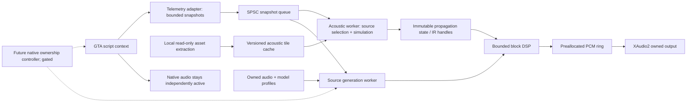

# Proposed architecture

**INFERRED recommendation; implementation and all timing budgets below are UNTESTED.** Build a hybrid, externally rendered acoustic system only after proving source ownership and telemetry. Do not assume the native engine exposes a general DSP insertion point.

## Phase 2 implementation boundary

Phase 2.1 acquired and inventoried the author-supplied Enhanced RPH runtime without changing the telemetry model or adapter. A conditional first-load manifest, system prerequisite review and numerical validation protocol are in [PHASE2_1_READINESS.md](docs/PHASE2_1_READINESS.md). No runtime-dependent facts about actual vehicle coverage or audio feasibility have been promoted to verified findings.

P2-01 now implements the telemetry portion in C# using `ITelemetrySource`, validity-aware fields, a session-local tracker, monotonic deadline scheduler, bounded SPSC queue and background JSONL writer. A standalone RPH adapter is compiled against the authentic SDK; the core and analyzer do not reference RPH. The reason for this adapter choice is new author evidence for Enhanced 1158.16 support plus a working managed compiler, not a change to the acoustic architecture. See [current implementation](docs/TELEMETRY_IMPLEMENTATION.md) and [runtime evidence](docs/RUNTIME_COMPATIBILITY.md).

Managed DTOs contain copied scalar/vector values and no live game entities; these are not claimed allocation-free POD or an audio callback implementation. The logger's writer runs in-process on a background thread. Future acoustic worker/IPC/rendering choices remain unimplemented and gated on P2-01 validation. Offline benchmark measurements are in [the validation report](docs/PHASE2_VALIDATION.md); the gameplay budgets below remain targets, not measured game performance. No Phase 3 work proceeds until live P2-01 acceptance.

## Options and decisions

| Option | Integration feasibility | Benefits / costs | Decision gate |
|---|---|---|---|
| Native metadata configuration | Actual RELs/curves/layers accessible; Enhanced deployment untested | Preserves engine synchronization and other game mixing; limited environmental algorithm control | Copied-asset round trip, compatible loader, audibility test |
| Supplement native sound | Own audio output is straightforward in isolation; source overlap unresolved | Can add a genuinely separate source component; adding a second complete engine creates duplication | Demonstrate separated content and no duplicated native component |
| Selective native replacement | Profile reassignment exists in source; engine-only mute/restore unverified | Full source/propagation control for a bounded vehicle set | Per-instance isolation + automatic restoration + collateral-sound tests |
| Steam Audio C API | Documented Windows C interface, geometry and effects; no native GTA integration | Avoids writing an entire acoustic solver; explicit scene/PCM/worker integration required | Standalone synthetic-scene render + scene matching + source ownership |
| Steam Audio + XAudio2 | Render blocks into owned PCM queue; device recovery is additional work | Clear separation between simulation/DSP and Windows playback | Measured latency, no starvation, endpoint/focus/pause tests |
| Custom solver/DSP | Possible in separate library, highest maintenance burden | Fill narrow gaps such as calibrated vehicle synthesis or selected diffraction approximations | Prove a specific missing capability and test against a simpler reference |
| FMOD/Wwise integration | Steam Audio supports these; no GTA plugin bus established | More middleware integration and license review; does not solve native source access | Only reconsider if a concrete GTA integration benefit is demonstrated |

Steam Audio's C API is a promising building block, not a finished mod, source synthesizer or playback engine [S9–S15]. XAudio2 supplies playback/mixing [S16]. No final technology commitment has been made. Prefer a CPU implementation first; reserve GPU acoustic work until CPU baselines and interference with GTA rendering are measured on this workstation.

## Boundaries and data flow

The game adapter is the only component permitted to call game/framework APIs. All workers use snapshots, not live game pointers. The native engine continues to mix dialogue, radio, ambience, collisions, horns and any unowned vehicle sources. No processing of the final game mix is proposed: that cannot reconstruct isolated moving sources or remove their existing reverb.

The current recorder is a minimal in-process managed plugin with off-fiber disk writes and offline replay/analysis. A future adapter can send versioned bounded telemetry through a local IPC channel, with epochs, capabilities and monotonic timestamps. An in-process renderer may reduce IPC complexity but shares crashes and thread risks with the game. Choose only after measuring; neither renderer topology has been implemented here.

## Source and listener state

A snapshot carries schema version, monotonically increasing sequence, simulation time, capture clock, source handle+generation, model hash, position, basis, velocity, engine state and per-field validity. Raw normalized RPM, estimated physical RPM and estimated load are distinct fields. Listener pose includes its camera mode and an epoch changed on a cut. Collect exact source family from authored model profiles; never derive cylinder count from vehicle class.

The source layer exposes owned engine, intake, mechanical, exhaust and optional tire components. A new component needs a declared native overlap policy. A native granular bank is useful research evidence, but extracting it does not provide a licensed library of dry, calibrated source recordings. No native PCM tap was established. Owned recordings, licensed synthesis or newly authored procedural signals are required for distributable rendering.

## Geometry pipeline

**VERIFIED starting point:** one YBN composite and its child geometry decode. **UNTESTED pipeline:** resolve YMAP placements, YTYP/MLO archetypes, YBN bounds and child transforms into a common world space; convert triangles and collision primitives; validate winding, meters, origin and all transforms against known landmarks. Translate coordinates to Steam Audio's right-handed Y-up convention [S10]. A candidate GTA Z-up mapping is `(x,y,z) -> (x,z,-y)`; test basis vectors and orientation before use rather than asserting this matches every exported matrix convention.

Build local tiles of initially 128 m side, with overlap or neighbor traversal to avoid false barriers at tile seams. Keep a near high-detail region and coarser distant reflectors, independent of visual rendering LOD. Preserve building faces, tunnel cross-sections and portal apertures; remove acoustically insignificant small triangles. Collision meshes omit some visual surfaces and may use closed proxy shapes that do not match openings. Validate each initial scene manually.

Materials map collision/visual categories to authored frequency-band absorption, scattering and transmission coefficients, with provenance and confidence. Avoid treating every collision material ID as a known physical substance. Two-sided walls need thickness/topology rules; do not apply transmission loss twice when a wall is represented by two faces. Store local caches keyed by game archive hashes, DLC state, converter version, coordinate convention, material version and simplification settings. No extracted mesh/probe/IR cache is committed or distributed.

Static scenes can use simplified meshes, locally baked probes/path connectivity and slow reflection updates. Moving doors and large vehicles use small rigid instances or a portal-state layer. Destruction, IPL swaps and interiors invalidate affected tiles and bakes. A closed door must not leave a stale open baked path. If current world state is unknown, suppress the unsupported reflected contribution rather than present a guessed path as measured geometry. Full-world dynamic matching remains unresolved.

Steam Audio offers static/instanced meshes and baked/reflection/path effects [S11–S15]; it does not automatically ingest GTA collision or provide all diffraction physics. Native shape tests can validate a few local direct paths, but calling script raycasts from Steam Audio worker callbacks is unsafe. An offline mesh ray tracer or a thread-safe custom-scene backend must answer worker queries without game calls.

## Scheduling and budgets

The following are **initial engineering targets, not benchmarks or known capacities**. Defaults intentionally restrict work before expansion. Audio defaults: 48 kHz float, 256-sample processing blocks (5.33 ms mathematical block duration), three queued blocks initially. This does not claim 16 ms end-to-end latency; OS/device buffering, resampling, IPC and simulation add delay. Measure actual output lag.

| Work / resource | Initial cap or acceptance target | Measurement / degradation |
|---|---|---|
| Telemetry | 20 Hz; 32 tracked sources, discovery 2 Hz | Adapter work p95 <0.5 ms, p99 <1 ms per sampling tick; log missed deadlines |
| Initial audible sources | 8 owned dry voices; at most 4 with expensive reflections | Promote by estimated band audibility and importance, with hysteresis |
| Direct occlusion | 20 Hz for significant sources; <=5 rays/source/update | At 8 sources, <=800 direct queries/s, an arithmetic cap only; async native queries lower and separately bounded |
| Reflection solve | Global 2,048-ray setting, <=2 bounces, 5 updates/s, <=4 selected sources | SDK ray setting semantics and actual cost measured; no claim that setting equals total ray count. Global work-time cutoff, skip overdue updates |
| Acoustic worker | Target <=2 ms p95 per scheduled solve on this machine | Record wall and CPU time; reduce source count/rays/update rate |
| DSP | Target <=1 ms p99 per 256-sample block for initial configuration | Tail preservation and preallocated reuse; reduce expensive reflections before direct source continuity |
| Main-frame impact | Paired runs: p95 frame time increase <1 ms, no >5 ms added hitch attributed to mod | Offline replay plus in-game ETW/PresentMon or equivalent after installing build tools |
| Snapshot queue | 4 snapshots, newest useful state wins | Drop stale data, count overflow; no blocking producer |
| Resident RichAudio memory | Initial cap 256 MiB; geometry sub-budget 128 MiB | Track allocations, cache eviction and high-water marks; fixed upper bounds |
| Stability | 30 min stress, then 2 h soak; no source-count/heap growth after warm-up | Endpoint reset, pause, teleport, unload, handle reuse, population turnover |
| Output health | Zero buffer starvation in acceptance run; counters sampled off callback | OnCriticalError/device recovery, underruns, late render blocks, clip/limiter counts |

Rank potential sources by estimated frequency-band received energy relative to background masking, source confidence, motion and importance; use distance only as a broad-phase bound. A reflecting corridor can keep an occluded source significant. A closer quiet source may be masked. Track cheap/coarse candidates separately from audible voice allocation. Do not create a full acoustic scene or high-quality convolution for every NPC each frame.

Full-resolution rays for all vehicles are rejected. Reuse static acceleration structures and cached path state, bounded by source/listener movement and door/geometry epochs. Crossfade IRs on a worker/DSP boundary to avoid discontinuities. Cache reuse has explicit maximum age; it cannot justify indefinitely stale moving-source acoustics.

## Real-time ownership and lifetime

XAudio2 callbacks must not perform disk IO, game calls, allocation, scene construction, blocking synchronization, IPC reads or heavy simulation [S16]. The render worker prepares PCM, and callbacks only recycle preallocated buffer tokens or signal work. If the producer misses a deadline, use a bounded fade rather than block. Include sequence/epoch counters to prevent stale buffer use after device reset.

Use an SPSC queue for one producer/consumer pair, with acquire/release atomics, fixed POD storage and no contested reclamation on the callback. If additional producers exist, marshal them before this boundary. Simulation effects and scene updates require documented SDK synchronization; publish immutable result generations and retire old IR/effect resources after consumers have released them. Never free a buffer still queued to XAudio2. Destroy voices and stop callbacks before releasing their backing state.

## Native coexistence state machine — gated design

States: `NativeOnly -> Prepared -> RichAudioOwned -> Restoring -> NativeOnly`; failures from every state return to NativeOnly **only where restoration is proven possible**. Prepared means owned audio is buffered, source identity validated, renderer healthy, and the controlled source's known native profile can be restored. Do not enter RichAudioOwned merely because a renderer opened a device.

No clean per-source native gain or dry tap is verified. Until P2-02 proves a reversible suppression method, the state machine stops at Prepared and owned engine audio stays inaudible. A hard game/plugin crash can prevent restoration of persistent native flags even if an external renderer survives; a watchdog cannot repair the game's state without a functioning adapter. Such methods fail the fail-open requirement unless proven self-expiring or recoverable.

Distance-dependent handoff is optional and late. Once ownership is available, select by contribution/audibility with hysteresis; do not toggle on a fixed radius every frame. For correlated phase-aligned stems a complementary linear gain crossfade may fit; for decorrelated material equal-power may fit. Neither eliminates comb filtering or onset mismatch by itself. Measure latency and correlation; avoid simultaneous native and owned direct components wherever alignment cannot be established. Native native-to-NPC LOD changes are also outside our ownership until tested.

If full replacement fails its gate, retain native sources and pursue metadata refinements or an offline acoustic research tool. A manually enabled separate sound component must be audibly distinct and declared as an approximation. Do not label duplicated synthetic engine layers a completed propagation overhaul.
