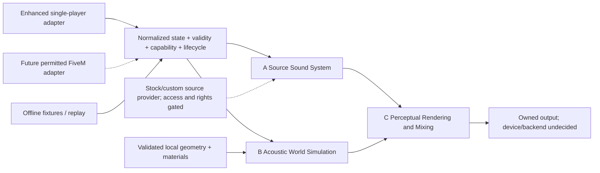
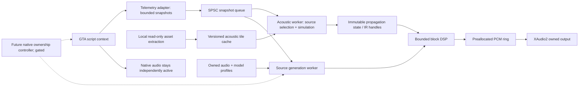

# Proposed architecture

**ACOUSTICS-08.2 implementation — 29 October 2026:** [Optional Direct3D11 visibility compute and functional quality controls](docs/ACOUSTICS_08_2_GPU_ACCELERATION.md) now extend the existing finite solver/streaming renderer. The CPU remains complete; the GPU supplies conservative potential-contact masks for exact CPU refinement. Explicit 12/16/32/64-path capacities and separately adaptive hardware selection preserve source history. Real RTX 2080 SUPER comparisons are bit-identical, but full simulation/DSP costs still exceed the block budget at demanding Quality/Max settings. No hardware ray-tracing backend, extra reflection order, late field or GTA rendering-performance claim is implied.

## Governing acoustic requirement — 29 October 2026

RichAudio must ultimately render a direct contribution, multiple simultaneous distinct early reflections and valid multi-bounce paths per source, together with an environment-dependent dense late-reverberation field where the available evidence supports one. A single reflected voice per source is not the target. The perceptual goal is physical presence: substantial nearby vehicles, convincing distance, and audible influence from roads, buildings, ceilings, tunnels and interiors. Arbitrary repeated echoes or a uniform reverb preset do not satisfy this requirement.

Continue extending the existing direct/first-/second-order solver, simulation worker and streaming renderer. Preserve these architectural constraints when their interfaces evolve:

- Keep bounded collections of contributions per source, with stable source/path identity, generation and surface-interaction sequence. Each discrete path carries propagation delay, arrival direction, frequency-dependent attenuation and the evidence/assumptions behind its finite geometric support. Do not reduce the interface to one reflection slot per source or encode a permanent second-order ceiling into the renderer contract.
- Selectively traced higher reflection orders must fit explicit work, path-count, memory and update budgets. Select and retire contributions by plausible received energy and importance while preserving direct-path continuity, source history, Doppler, spatialisation and smooth movement/geometry transitions. Expensive tracing remains outside the audio callback.
- Reserve an additive, bounded late-field contribution at the existing simulation-to-rendering boundary. Its future contract must associate excitation/history, delay, directional distribution, band-dependent decay/attenuation and surface/scattering assumptions with the relevant source/environment context. It need not enumerate every diffuse bounce as a discrete early path. Budget tail state, duration, update work and rendering cost; define the early/late energy handoff to avoid double counting. This is an interface requirement, not a second renderer or a prescribed reverberation algorithm.
- Preserve geometry/session identity, original observation age, uncertainty and coordinate/scale provenance through both early and late contributions. Sparse wall/ground observations do not establish enclosure volume, complete visibility, material calibration or a measured decay time. Unknown properties stay unknown; any demonstration calibration or authored approximation must remain explicit. Unsupported/stale geometry must not be reported as fresh support for a tail. Transitions and retained tails need bounded ownership and invalidation behavior without resetting unrelated sources.

Future acoustic acceptance must demonstrate concurrent direct and multiple distinguishable early arrivals, valid multi-bounce timing and surface interactions, and selectively higher orders when added. Matched source/pose comparisons must show an environment-supported dense late tail changing appropriately between open and enclosed settings, with plausible band decay and directional behavior. Numerical and PCM checks must cover bounded energy/headroom, smooth motion and scene changes, preserved source history and measured CPU/memory/deadline limits. Supervised perceptual comparisons must assess nearby weight, distance and environmental character without relying on arbitrary gain boosts or echoes; unverified physical assumptions must remain labelled.

The current ACOUSTICS-08.1 publisher/relay increment remains scoped to observation transport and the existing engine. It does not implement late reverberation, additional reflection orders or new live acceptance, and this requirement creates no additional preparation stage for that increment. Source ownership, historical evidence, sealed candidates and the combined 60% milestone remain unchanged.

**ACOUSTICS-06 implementation:** The [original offline acoustic engine](docs/ACOUSTICS_06_AUDIO_PROPAGATION_ENGINE.md) now implements a metric scene/source contract, retarded-time finite-path solver and bounded stereo PCM processor under `src/acoustics/engine`. Simulation preparation is separate from sample processing. This is a working Node reference backend with no game or device dependency, not an in-process GTA renderer. Historical proposals below remain useful integration context; native ownership, calibrated GTA units, live snapshot transport and output hosting are still separate gates.

**Parallel ACOUSTICS-01 research:** [local geometry and first-order paths](docs/ACOUSTICS_01_LOCAL_GEOMETRY.md) now have an independent original-fixture prototype under `src/acoustics/research`. It provides no game adapter, source synthesis or audio output. This narrowly authorised offline work does not clear telemetry, native ownership or live Phase 3 gates; the broader proposals below remain future architecture.

## Master vision alignment — 25 October 2026

The existing adapter/snapshot/worker/output separation supports the broader vision without changing the telemetry checkpoint. The three responsibilities below refine the future workers; they do not introduce an audio engine into P2-01. Current implementation is managed telemetry only. A reusable C++ acoustic core remains proposed, with no portable C++ build target yet. The [latest runtime attempt](docs/P2_01_ENHANCED_RUNTIME_ATTEMPT.md) resolved executable selection but failed before hook/plugin verification.

| Responsibility | Consumes / produces | Independent future validation |
|---|---|---|
| A. Source Sound System | Validity-aware state, authoritative events, licensed/local source material and optional authored profiles → isolated source voices, physical radiator locations, band emission/directivity and timing | Engine identity/load response, rotor modulation, jet power/direction, authentic impulses; no invented events or calibrated RPM without evidence |
| B. Acoustic World Simulation | Source/listener snapshots, geometry/material confidence, atmosphere assumptions → versioned direct/indirect path delays, band losses, directions and bounded reflection state | Analytic free field/plane/portal scenes, energy/delay checks, geometry-driven obstruction, diffraction approximation limits |
| C. Perceptual Rendering and Mixing | Owned voices plus path state → bounded PCM/output, device routing and diagnostics | Consumer stereo/headphones, spatial clarity and source scale, dynamic contrast, controlled contextual shaping, headroom and endpoint recovery |

Only adapters call platform APIs. Core contracts carry copied values, explicit metres/metres-per-second, monotonic times, epochs, source generations and per-field observed/estimated/unavailable status. Platform pause/time scaling, camera cuts and discontinuities must be explicit. A source-provider capability contract declares supported formats, provenance, native overlap and restore policy; the acoustic simulation must not depend on a sound-pack filename or RPH entity type. No final PCM/IPC ABI is frozen until measured requirements justify it.

### Stock and custom source routing gate

| Route | What it enables | Current evidence / boundary |
|---|---|---|
| Isolated native sound processing before mix | Preserve native voice while applying independent source DSP | No supported isolated PCM insertion point established; not interchangeable with metadata access |
| Reproduce installed stock assets through an owned renderer | Independent propagation using stock source material without changing original archives | Containers/references inspected; usable dry source reconstruction, synchronized behavior, local-use/redistribution rights and native suppression remain unresolved |
| Supported native audio configuration | Alter native playback within supported configuration capability | Metadata formats researched; runtime behavior/rollback requires a separate approved experiment; not arbitrary PCM DSP |
| Process final mixed output | Whole-mix tonal/dynamic processing | Cannot recover independently positioned voices, undo baked reflections or provide per-source ownership; insufficient for the core vision |

Stock archives remain untouched and wholesale replacement is not a base-product requirement. Local asset access does not authorize asset distribution. Where a route is unsupported, keep native playback rather than claiming a stock-compatible overhaul. New licensed/owned optional packs are permissible future source providers, not the default substitute for proving stock support. Every route must prove duplication-free direct sound, restoration and unrelated native audio preservation before enabling output.

Custom-content compatibility is tracked per format and integration: **native compatible**, **adapter required**, or **unsupported/unverified**. No arbitrary existing pack is currently certified. Optional profiles can declare engine layout/calibration, exhaust/rotor characteristics, event category, radiation and provenance. Omitted metadata stays unknown; inferred metadata must retain confidence. Changing a pack should not require rewriting propagation or device mixing.

### Continuity and future platforms

Source identity combines session/adapter epoch and generation; recycled handles never establish persistent identity alone. Future acoustic continuity may retain a bounded last-known trajectory with an explicit prediction age/error envelope, then fade and terminate. Unloaded RPM/load remain unknown. Reacquisition requires authoritative identity evidence or a labelled uncertain match; it must not merge unrelated vehicles or create indefinite ghosts. Smooth fading is a future rendering responsibility, not implemented telemetry behavior.

FiveM affects contracts now, not scope: optional client integration must respect platform/server permissions, available APIs and player opt-out. A future server resource might relay authorized distant state with ownership, ordering, timestamps, interpolation bounds, rate/bandwidth caps and access controls. Client/server clock mapping cannot assume a common monotonic origin. Evaluate fairness and information disclosure before sending otherwise unstreamed positions. Ordinary resources are not assumed to deploy arbitrary native C++ renderers. No FiveM runtime or network implementation is authorized here.

Aircraft and impulses need additional capability contracts: rotor configuration/loading, jet power, authoritative supersonic state and event timestamps are not supplied by the current vehicle logger. Preserve engine/rotor/exhaust distinctions and finite source extents; do not generate arbitrary backfires or shockwaves. Geometry, source emission and perceptual translation remain independently testable with one coherent scene.

**INFERRED recommendation; implementation and all timing budgets below are UNTESTED.** Build a hybrid, externally rendered acoustic system only after proving source ownership and telemetry. Do not assume the native engine exposes a general DSP insertion point.

## Phase 2 implementation boundary

The first authorised runtime attempt stopped at an unsupported target/version reported by RPH before GTA or the adapter started. This supplies no evidence against the telemetry data model; it adds a runtime-selection readiness gate when multiple executable versions coexist. Keep the exact Enhanced guard and public-API boundary. [Actual outcome](docs/P2_01_FIRST_RUNTIME_ATTEMPT.md); original game files were preserved and deployment additions rolled back.

Phase 2.1 acquired and inventoried the author-supplied Enhanced RPH runtime without changing the telemetry model or adapter. A conditional first-load manifest, system prerequisite review and numerical validation protocol are in [PHASE2_1_READINESS.md](docs/PHASE2_1_READINESS.md). No runtime-dependent facts about actual vehicle coverage or audio feasibility have been promoted to verified findings.

P2-01 now implements the telemetry portion in C# using `ITelemetrySource`, validity-aware fields, a session-local tracker, monotonic deadline scheduler, bounded SPSC queue and background JSONL writer. A standalone RPH adapter is compiled against the authentic SDK; the core and analyzer do not reference RPH. The reason for this adapter choice is new author evidence for Enhanced 1158.16 support plus a working managed compiler, not a change to the acoustic architecture. See [current implementation](docs/TELEMETRY_IMPLEMENTATION.md) and [runtime evidence](docs/RUNTIME_COMPATIBILITY.md).

Managed DTOs contain copied scalar/vector values and no live game entities; these are not claimed allocation-free POD or an audio callback implementation. The logger's writer runs in-process on a background thread. Future acoustic worker/IPC/rendering choices remain unimplemented and gated on P2-01 validation. Offline benchmark measurements are in [the validation report](docs/PHASE2_VALIDATION.md); the gameplay budgets below remain targets, not measured game performance. No Phase 3 work proceeds until live P2-01 acceptance.

## Options and decisions

| Option | Integration feasibility | Benefits / costs | Decision gate |
|---|---|---|---|
| Native metadata configuration | Actual RELs/curves/layers accessible; Enhanced deployment untested | Preserves engine synchronization and other game mixing; limited environmental algorithm control | Copied-asset round trip, compatible loader, audibility test |
| Supplement native sound | Own audio output is straightforward in isolation; source overlap unresolved | Can add a genuinely separate source component; adding a second complete engine creates duplication | Demonstrate separated content and no duplicated native component |
| Selective native replacement | Profile reassignment exists in source; engine-only mute/restore unverified | Full source/propagation control for a bounded vehicle set | Per-instance isolation + automatic restoration + collateral-sound tests |
| Steam Audio C API | Documented Windows C interface, geometry and effects; no native GTA integration | Avoids writing an entire acoustic solver; explicit scene/PCM/worker integration required | Standalone synthetic-scene render + scene matching + source ownership |
| Steam Audio + XAudio2 | Render blocks into owned PCM queue; device recovery is additional work | Clear separation between simulation/DSP and Windows playback | Measured latency, no starvation, endpoint/focus/pause tests |
| Custom solver/DSP | Possible in separate library, highest maintenance burden | Fill narrow gaps such as calibrated vehicle synthesis or selected diffraction approximations | Prove a specific missing capability and test against a simpler reference |
| FMOD/Wwise integration | Steam Audio supports these; no GTA plugin bus established | More middleware integration and license review; does not solve native source access | Only reconsider if a concrete GTA integration benefit is demonstrated |

Steam Audio's C API is a promising building block, not a finished mod, source synthesizer or playback engine [S9–S15]. XAudio2 supplies playback/mixing [S16]. No final technology commitment has been made. Prefer a CPU implementation first; reserve GPU acoustic work until CPU baselines and interference with GTA rendering are measured on this workstation.

## Boundaries and data flow

The game adapter is the only component permitted to call game/framework APIs. All workers use snapshots, not live game pointers. The native engine continues to mix dialogue, radio, ambience, collisions, horns and any unowned vehicle sources. No processing of the final game mix is proposed: that cannot reconstruct isolated moving sources or remove their existing reverb.

The current recorder is a minimal in-process managed plugin with off-fiber disk writes and offline replay/analysis. A future adapter can send versioned bounded telemetry through a local IPC channel, with epochs, capabilities and monotonic timestamps. An in-process renderer may reduce IPC complexity but shares crashes and thread risks with the game. Choose only after measuring; neither renderer topology has been implemented here.

## Source and listener state

A snapshot carries schema version, monotonically increasing sequence, simulation time, capture clock, source handle+generation, model hash, position, basis, velocity, engine state and per-field validity. Raw normalized RPM, estimated physical RPM and estimated load are distinct fields. Listener pose includes its camera mode and an epoch changed on a cut. Collect exact source family from authored model profiles; never derive cylinder count from vehicle class.

The proposed source layer separates engine, intake, mechanical, exhaust and optional tire components. A new component needs a declared native overlap policy. A native granular bank is useful research evidence, but extraction does not establish a dry, calibrated source library or redistribution rights. No native PCM tap was established. Locally accessed stock/custom content is a gated provider option; any distributed source material must be original or appropriately licensed. Mandatory replacement recordings are not the product requirement.

## Geometry pipeline

**27 October 2026 qualification:** the installation-aware two-layer architecture and bounded offline tile-cache prototype are specified in [INSTALLATION_AWARE_ACOUSTIC_CACHE.md](docs/INSTALLATION_AWARE_ACOUSTIC_CACHE.md). Cached inferred patches always reload as historical/invalid, never authoritative. Real installation identity remains partial; matching game versions or supplied resource hashes does not establish complete mod detection. The older mesh/tile dimensions and archive-conversion proposals below are future design targets, not the dimensions or implemented capabilities of this prototype. No startup/background collision scan, whole-install hash pass, city connectivity solver or audio-thread disk IO is introduced. The tiny synthetic guarded-cache load is slower than reconstruction; performance benefits remain unproven.

**VERIFIED starting point:** one YBN composite and its child geometry decode. **UNTESTED pipeline:** resolve YMAP placements, YTYP/MLO archetypes, YBN bounds and child transforms into a common world space; convert triangles and collision primitives; validate winding, meters, origin and all transforms against known landmarks. Translate coordinates to Steam Audio's right-handed Y-up convention [S10]. A candidate GTA Z-up mapping is `(x,y,z) -> (x,z,-y)`; test basis vectors and orientation before use rather than asserting this matches every exported matrix convention.

Build local tiles of initially 128 m side, with overlap or neighbor traversal to avoid false barriers at tile seams. Keep a near high-detail region and coarser distant reflectors, independent of visual rendering LOD. Preserve building faces, tunnel cross-sections and portal apertures; remove acoustically insignificant small triangles. Collision meshes omit some visual surfaces and may use closed proxy shapes that do not match openings. Validate each initial scene manually.

Materials map collision/visual categories to authored frequency-band absorption, scattering and transmission coefficients, with provenance and confidence. Avoid treating every collision material ID as a known physical substance. Two-sided walls need thickness/topology rules; do not apply transmission loss twice when a wall is represented by two faces. Store local caches keyed by game archive hashes, DLC state, converter version, coordinate convention, material version and simplification settings. No extracted mesh/probe/IR cache is committed or distributed.

Static scenes can use simplified meshes, locally baked probes/path connectivity and slow reflection updates. Moving doors and large vehicles use small rigid instances or a portal-state layer. Destruction, IPL swaps and interiors invalidate affected tiles and bakes. A closed door must not leave a stale open baked path. If current world state is unknown, suppress the unsupported reflected contribution rather than present a guessed path as measured geometry. Full-world dynamic matching remains unresolved.

Steam Audio offers static/instanced meshes and baked/reflection/path effects [S11–S15]; it does not automatically ingest GTA collision or provide all diffraction physics. Native shape tests can validate a few local direct paths, but calling script raycasts from Steam Audio worker callbacks is unsafe. An offline mesh ray tracer or a thread-safe custom-scene backend must answer worker queries without game calls.

## Scheduling and budgets

The following are **initial engineering targets, not benchmarks or known capacities**. Defaults intentionally restrict work before expansion. Audio defaults: 48 kHz float, 256-sample processing blocks (5.33 ms mathematical block duration), three queued blocks initially. This does not claim 16 ms end-to-end latency; OS/device buffering, resampling, IPC and simulation add delay. Measure actual output lag.

| Work / resource | Initial cap or acceptance target | Measurement / degradation |
|---|---|---|
| Telemetry | 20 Hz; 32 tracked sources, discovery 2 Hz | Adapter work p95 <0.5 ms, p99 <1 ms per sampling tick; log missed deadlines |
| Initial audible sources | 8 owned dry voices; at most 4 with expensive reflections | Promote by estimated band audibility and importance, with hysteresis |
| Direct occlusion | 20 Hz for significant sources; <=5 rays/source/update | At 8 sources, <=800 direct queries/s, an arithmetic cap only; async native queries lower and separately bounded |
| Reflection solve | Global 2,048-ray setting, <=2 bounces, 5 updates/s, <=4 selected sources | SDK ray setting semantics and actual cost measured; no claim that setting equals total ray count. Global work-time cutoff, skip overdue updates |
| Acoustic worker | Target <=2 ms p95 per scheduled solve on this machine | Record wall and CPU time; reduce source count/rays/update rate |
| DSP | Target <=1 ms p99 per 256-sample block for initial configuration | Tail preservation and preallocated reuse; reduce expensive reflections before direct source continuity |
| Main-frame impact | Paired runs: p95 frame time increase <1 ms, no >5 ms added hitch attributed to mod | Offline replay plus in-game ETW/PresentMon or equivalent after installing build tools |
| Snapshot queue | 4 snapshots, newest useful state wins | Drop stale data, count overflow; no blocking producer |
| Resident RichAudio memory | Initial cap 256 MiB; geometry sub-budget 128 MiB | Track allocations, cache eviction and high-water marks; fixed upper bounds |
| Stability | 30 min stress, then 2 h soak; no source-count/heap growth after warm-up | Endpoint reset, pause, teleport, unload, handle reuse, population turnover |
| Output health | Zero buffer starvation in acceptance run; counters sampled off callback | OnCriticalError/device recovery, underruns, late render blocks, clip/limiter counts |

Rank potential sources by estimated frequency-band received energy relative to background masking, source confidence, motion and importance; use distance only as a broad-phase bound. A reflecting corridor can keep an occluded source significant. A closer quiet source may be masked. Track cheap/coarse candidates separately from audible voice allocation. Do not create a full acoustic scene or high-quality convolution for every NPC each frame.

Full-resolution rays for all vehicles are rejected. Reuse static acceleration structures and cached path state, bounded by source/listener movement and door/geometry epochs. Crossfade IRs on a worker/DSP boundary to avoid discontinuities. Cache reuse has explicit maximum age; it cannot justify indefinitely stale moving-source acoustics.

## Real-time ownership and lifetime

XAudio2 callbacks must not perform disk IO, game calls, allocation, scene construction, blocking synchronization, IPC reads or heavy simulation [S16]. The render worker prepares PCM, and callbacks only recycle preallocated buffer tokens or signal work. If the producer misses a deadline, use a bounded fade rather than block. Include sequence/epoch counters to prevent stale buffer use after device reset.

Use an SPSC queue for one producer/consumer pair, with acquire/release atomics, fixed POD storage and no contested reclamation on the callback. If additional producers exist, marshal them before this boundary. Simulation effects and scene updates require documented SDK synchronization; publish immutable result generations and retire old IR/effect resources after consumers have released them. Never free a buffer still queued to XAudio2. Destroy voices and stop callbacks before releasing their backing state.

## Native coexistence state machine — gated design

States: `NativeOnly -> Prepared -> RichAudioOwned -> Restoring -> NativeOnly`; failures from every state return to NativeOnly **only where restoration is proven possible**. Prepared means owned audio is buffered, source identity validated, renderer healthy, and the controlled source's known native profile can be restored. Do not enter RichAudioOwned merely because a renderer opened a device.

No clean per-source native gain or dry tap is verified. Until P2-02 proves a reversible suppression method, the state machine stops at Prepared and owned engine audio stays inaudible. A hard game/plugin crash can prevent restoration of persistent native flags even if an external renderer survives; a watchdog cannot repair the game's state without a functioning adapter. Such methods fail the fail-open requirement unless proven self-expiring or recoverable.

Distance-dependent handoff is optional and late. Once ownership is available, select by contribution/audibility with hysteresis; do not toggle on a fixed radius every frame. For correlated phase-aligned stems a complementary linear gain crossfade may fit; for decorrelated material equal-power may fit. Neither eliminates comb filtering or onset mismatch by itself. Measure latency and correlation; avoid simultaneous native and owned direct components wherever alignment cannot be established. Native native-to-NPC LOD changes are also outside our ownership until tested.

If full replacement fails its gate, retain native sources and pursue metadata refinements or an offline acoustic research tool. A manually enabled separate sound component must be audibly distinct and declared as an approximation. Do not label duplicated synthetic engine layers a completed propagation overhaul.
