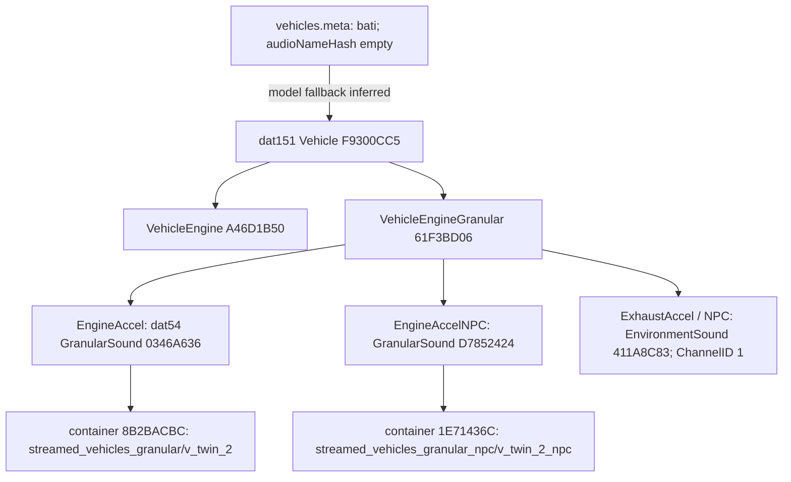

# GTA audio research

**P2-03 actual decoding:** [twelve stock PCM streams and private listening evidence](docs/P2_03_STOCK_AUDIO_RECONSTRUCTION.md) now validate usable waveform data for the Bati-traced family. Raw PCM and WAV payloads match exactly; archive hashes are unchanged. The initial grain demo failed listening. A limited 19-second continuous-recording reference was received positively, with deceleration phasing unresolved. Neither is a verified native granular model. This supersedes earlier waveform-not-exported status, while native suppression/ownership remains unresolved.

**25 October P2-02 update:** [stock source access and native ownership](docs/P2_02_AUDIO_OWNERSHIP.md). The reviewed CodeWalker source identifies codec 0 as PCM and provides raw/PCM/WAV paths, but the sampled stock data has not been exported or playback-validated. Granular reconstruction, per-instance engine/exhaust suppression, unrelated-sound preservation and fail-open recovery remain unverified. Public siren controls are a separate category-specific lead, not proof of engine ownership. No new game/audio experiment was performed.

Investigation: 24 October 2026. See [SOURCES.md](SOURCES.md) for evidence identifiers. All findings concern the installed files unless an upstream source is explicitly named. Parser labels reflect CodeWalker dev46 reverse engineering, not a Rockstar audio specification.

## Actual inspection

**VERIFIED [E1–E5]:** the following physical archives were opened using `CodeWalker.Core.dll` from the supplied dev46 folder. Before/after SHA-256 hashes match for each, including repeated observations. Exact lengths and hashes are in `evidence/archive-integrity.json`.

| Archive relative to game root | What was inspected |
|---|---|
| `x64/audio/audio_rel.rpf` | 20 root entries; 17 REL files exported and parsed |
| `x64/audio/occlusion.rpf` | 472 root entries; sampled `1002169370.ymt` parsed |
| `x64/audio/sfx/STREAMED_VEHICLES_GRANULAR.rpf` | 65 root entries; Bati and other selected AWC tables loaded |
| `x64/audio/sfx/STREAMED_VEHICLES_GRANULAR_NPC.rpf` | 58 root entries; Bati/NPC tables loaded |
| `common.rpf` | Base `data/levels/gta5/vehicles.meta` exported |
| `update/update.rpf` | Root + 220 immediate child archives, recursive inventory; 18 RELs, 39 vehicle metadata files; sample YBN and nested occlusion YMT parsed |
| `x64a.rpf` | Directory structure inspected; no full world geometry export |
| `update/x64/dlcpacks/mpbiker/dlc.rpf` | Recursive inventory, vehicle metadata, five audio RELs |
| `update/x64/dlcpacks/mp2025_02/dlc.rpf` | Recursive inventory, vehicle metadata, five audio RELs |
| `update/x64/dlcpacks/mp2025_02_g9ec/dlc.rpf` | Structure inspected; includes vehicle fragment resources; no REL parse result here |

**VERIFIED [E2]:** 45 distinct REL files parsed without reported errors. Base `game.dat151.rel` has 18,945 records; update has 18,944. Base `sounds.dat54.rel` has 56,599; update has 56,648. Update includes `dlcg9ec_game.dat151.rel` (5,729 records), `dlcg9ec_sounds.dat54.rel` (1,661), and `dlcg9ec_amp.dat10.rel` (201). Biker DLC has 603 game/1,927 sound records; sampled 2025 DLC has 370/863. These are parser record counts, not active voices.

**VERIFIED [E6]:** CodeWalker's GUI displayed the archive's 18 config-directory files, then opened `game.dat151.rel` as XML in its REL editor. The programmatic path used the supplied library directly. A newer upstream source checkout was consulted separately; it was not substituted for the supplied DLL.

## Resource roles

| Resource | Evidence-backed role and limit |
|---|---|
| RPF | Archive/directory layer with nested archives and compressed/encrypted entries. Successful listing alone does not demonstrate every enclosed resource decoder works. |
| AWC | Container of identified audio streams and format/chunk metadata. Bati containers contain separate engine/exhaust, acceleration/idle and player deceleration streams. Loading a stream table is not a playback or granular resynthesis test. |
| dat151 | Game-facing metadata: Vehicle, VehicleEngine, VehicleEngineGranular, interiors, rooms, emitters and materials were observed. It connects a vehicle identifier to several sound families. |
| dat54 | Sound graph: GranularSound, EnvironmentSound, wrappers, crossfades and variable-controlled nodes. Container and stream references are distinct from game-object identifiers. |
| dat16 | Curves: update has 815 records, including piecewise-linear, one-over-x-squared, default distance attenuation and distance attenuation table types. A curve name/type does not prove which runtime branch uses it. |
| dat15/dat22 | Observed mix/dynamix and categories metadata. These are promising configuration surfaces, without a proven external bus injection interface. |
| dat10 | Observed synth/amp definitions including Enhanced-specific update data. Not decoded into a replacement synthesizer here. |
| `vehicles.meta` | Contains model and `audioNameHash` identifiers, class and other vehicle configuration. Blank identifiers are common. |
| `occlusion.rpf/*.ymt` | Sampled PSO metadata describes interior/room/portal connectivity. It is not evidence of a complete triangle-based outdoor propagation solver. |

These roles follow the locally decoded structures [E2–E5] and CodeWalker's parser implementation [S1]. Many `Unk*` fields remain. Do not assign units or semantics to them from their numerical values alone.

## Bati reference chain

**VERIFIED [E3]:** update `vehicles.meta` contains `modelName=bati`, class `VC_MOTORCYCLE`, and an empty `audioNameHash`. Base metadata also contains the model. Jenkins hashing `bati` gives `0xF9300CC5`; both base and update dat151 contain that Vehicle record with the same engine references. **INFERRED:** an empty audio identifier defaults to the model identifier at runtime. The metadata match supports this, but actual runtime selection was not observed.

The container identifiers match hashes of the bank/stem strings shown above and resolve to actual AWC entries. The player GranularSound references six channels: `engine_accel`, `exhaust_accel`, `engine_decel`, `exhaust_decel`, `engine_idle`, `exhaust_idle`. NPC references four corresponding acceleration/idle channels; its deceleration container references are zero. Its ParentSound points to `0346A636`. The exhaust EnvironmentSound has channel ID 1 and no direct container pointer; interpreting that as a granular channel binding is **INFERRED**, not an independently followed AWC pointer.

**VERIFIED [E4]:** `v_twin_2.awc` loads as version 1 with eight streams; six names match the player graph, plus two unresolved stream hashes. `v_twin_2_npc.awc` has four streams. All sampled format chunks report 48,000 samples/second and codec ID 0. No PCM was saved or listened to. Details are in `evidence/bati-awc-summary.json`; reference edges are in `evidence/vehicle-trace.json`.

**VERIFIED [E3]:** search for Bati's Vehicle hash across all inspected dat151 XMLs found only the base and update `game` records. This includes the inspected Enhanced-specific update and two DLC sets, not every installed DLC. Complete mount precedence, content changesets and runtime registration remain **UNTESTED**. The tracer does not resolve all overlays automatically.

This is a useful representative motorcycle, but the container naming indicates a V-twin family. It does not validate an inline-four motorcycle source model. Select and trace a different model explicitly before the inline-four experiment.

## Engine generation and spatial controls

**VERIFIED [E3]:** Bati's granular settings expose MasterVolume, separate engine/exhaust volume, idle and acceleration controls, submix references, limiter parameters and NPC sound references. Its conventional VehicleEngine record also has low/high layers, transmission, ignition, shutdown and intake references. Engine replacement must consider both records and transitions, not just overwrite one AWC.

**VERIFIED [E2]:** decoded dat54 headers contain Volume and DopplerFactor fields; crossfade nodes contain MinDistance, MaxDistance, hysteresis and curve/variable references. These are different concepts: crossfade distances are not automatically maximum audible distances. The update dat151 includes 238 Interior, 632 InteriorRoom, 17 InteriorRoomParams and 408 AudioMaterial records. Room/send/filter labels and the portal samples establish authored environmental audio data, not a measured description of the native algorithm.

**INFERRED:** configured layer levels, graph choices and curves can shape native sources while retaining native spatial rendering. **UNTESTED:** saving edited RELs, registering them in Enhanced, hearing the change, determining actual gain units, runtime interpolation, channel budgeting and curve evaluation. No write/round-trip test was attempted against originals. Changes require local copies and a verified Enhanced loader first.

**UNTESTED / unavailable in researched interfaces:** dry native engine PCM capture, stable native voice handles for arbitrary engine loops, adding an arbitrary external convolution effect to a native bus, and exact runtime propagation/virtualization internals. No such supported interface was established by the inspected parser or scripting sources. This is a scoped negative finding, not proof that reverse engineering could never find one.

## Coexistence findings

**VERIFIED upstream [S3]:** `FORCE_USE_AUDIO_GAME_OBJECT` (`0x4F0C413926060B38`) assigns a vehicle audio profile. It does not document an engine-only gain, dry stem tap, crossfade, or previous-profile getter. Selecting a different profile may affect multiple vehicle sounds. **UNTESTED:** Enhanced behavior and restoration of a known profile.

**VERIFIED upstream [S4]:** `_SET_VEHICLE_SILENT` (`0x9D44FCCE98450843`) exists in the VEHICLE namespace. Its community documentation describes door/horn effects; it does **not** establish selective engine muting. Do not use its name as proof. Damage-factor natives likewise modify damage behavior rather than documenting an engine mute.

**VERIFIED upstream [S5]:** SET_AUDIO_VEHICLE_PRIORITY documents native audio LOD hints and mentions a five-granular-car limit. That is a community observation, **not a verified Enhanced limit**. Increasing priority globally is not a solution to missing NPC sources and may steal other native voices.

Script-created sound IDs can be stopped/released, but that does not confer ownership of automatic engine voices. No reversible per-instance engine-only attenuation, native reroute, phase-aligned handoff or failure restoration has been verified. Keep native audio fully active in the first logger experiment. Full replacement is gated on P2-02; supplemental renderer playback is gated on owned source separation and duplication controls.

## Geometry findings

**VERIFIED [E5]:** base occlusion sample `1002169370.ymt` decodes to `naOcclusionInteriorMetadata` with portal and room indexes, destination interiors and entity lists. A nested update occlusion sample (`1002641087.ymt`) also loads. This gives a research path for portal graphs, not material transmission coefficients or complete mesh boundaries.

**VERIFIED [E5]:** `update/update.rpf/dlc_patch/mpapartment/x64/levels/gta5/_hills/cityhills_02/ch2_04.rpf/apa_ch2_04_0.ybn` loads as BoundComposite with six BoundBVH children. Their vertices, polygons, materials and transforms can be enumerated. See the derived counts; no mesh data is committed. This is one actual geometry decode, not validation of whole-world transforms, topology, streaming or all Enhanced formats.

**INFERRED:** a local YBN/YMAP/YTYP pipeline can supply simplified static geometry after validating placements and selected DLC state. **UNTESTED:** world-space mesh reconstruction, MLO instancing, all collision primitive conversions, door states and acoustic material mapping. Physics materials and visual surface tags do not directly supply absorption/transmission spectra.

## Explicit unfinished work

No live telemetry, game audio listening test, native mute test, source separation, runtime geometry match, frame-time benchmark or Steam Audio/XAudio2 integration was performed. Archive preservation was checked for the ten archives touched; the entire 103 GB installation was not content-hashed or asserted to be a pristine Steam baseline. Preserve the current installation and obtain runtime compatibility evidence before any Phase 2 deployment.
