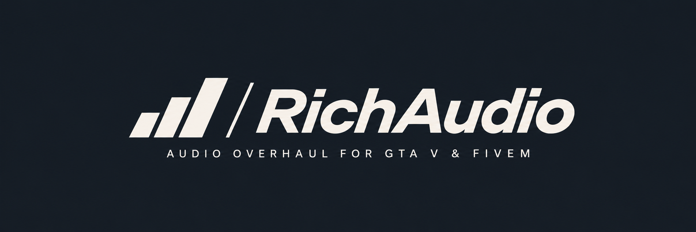

  <strong>GTA V, reimagined through sound.</strong>

  <a href="docs/DEVELOPMENT_PROGRESS.md">Progress</a> ·
  <a href="ROADMAP.md">Roadmap</a> ·
  <a href="ARCHITECTURE.md">Architecture</a> ·
  <a href="GTA_AUDIO_RESEARCH.md">Research</a>

I'm building **RichAudio** as an audio overhaul for **GTA V Enhanced**. My goal is to make Los Santos feel physically present: engines with weight, distant rotor pulses, convincing direction and depth, and environments that shape what you hear.

> **In development.** I haven't released a playable public build yet.

## The vision

- **Presence** — powerful engines, convincing bass and natural dynamic range.
- **Distance** — vehicles, aircraft, sirens and gunfire that carry naturally through the world.
- **Environment** — sound shaped by buildings, tunnels, interiors and open spaces.
- **Compatibility** — enhance GTA's original audio wherever possible and support compatible community sound mods, without permanently editing Rockstar's audio files.

These are my design goals. I'm targeting **PC single-player first**; future **FiveM support** is still exploratory. I'm not building RichAudio for GTA Online.

## Development progress

**1 November 2026 · First live vehicle audio.** I heard RichAudio's Bati engine and exhaust audio running in GTA V Enhanced Story Mode, driven by live gameplay telemetry.

I've also tested vehicle telemetry and camera-responsive audio in-game, alongside offline work on acoustic rendering, vehicle synthesis and the Windows audio pipeline. These remain experimental prototypes: latency, calibration, camera transitions, coexistence with GTA's original sounds and gameplay performance still need validation.

[Full milestone log and evidence](docs/DEVELOPMENT_PROGRESS.md) · [Known challenges](RISKS.md)

Watch or star this repository to follow my progress.

## Acknowledgements

**[dexyfex](https://github.com/dexyfex)**, creator of **[CodeWalker](https://github.com/dexyfex/CodeWalker)**. I plan to use CodeWalker to inspect world geometry and create acoustic maps for obstruction and reflections. CodeWalker is an independent project; this credit does not imply affiliation or endorsement.

---

*I'm developing RichAudio as an independent fan project, unaffiliated with Rockstar Games or Take-Two Interactive. I don't distribute Rockstar game files here, and I haven't announced a public software licence.*
