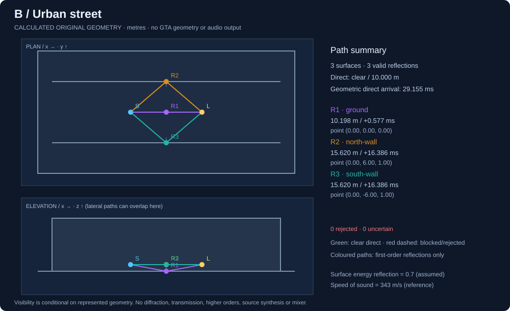

# ACOUSTICS-01: foundations of my acoustic world model

26 October 2026. **PASS — original synthetic geometry and first-order path research only.** I've implemented a bounded, immutable local tile and a tested finite-surface image-source prototype. Open, built-up and obstructed scenes produce different calculated paths because their geometry differs. No location label triggers an effect. This establishes neither a Los Santos scene model nor audible environmental acoustics.

My three responsibilities remain separate: Source Sound System → Acoustic World Simulation → Perceptual Rendering/Mixing. This module belongs only to the middle responsibility. I have not changed source synthesis, decoding, eligibility, RPM, telemetry, native ownership or the mixer. P2-03.12 and every blocked live audio/Phase 3 release gate remain separate.

## Repository choice and evidence levels

I've based `research/acoustics-01-local-geometry` directly on fetched canonical main `e5fbd8f3502d3e28169a224caa07471e090e368f`, in an isolated worktree. PRs #24 and #25 remain open/unmerged. This parallel PR therefore contains no unmerged synthesis experiments. The synthesis checkout remains at `24e1be70eb75c8f7b43e95fe495d3c71dba5dc42`; its history and private outputs are preserved. Existing newer findings are acknowledged through [PR #25](https://github.com/icydv/RichAudio/pull/25), without merging or rewriting them.

**VERIFIED FROM SOURCE** below means an SDK declaration, vendor document or previously stored parse record supports the named facility. **OFFLINE TESTED** means original-fixture calculations ran successfully. Neither means **VERIFIED IN GAME**. No geometry API has been verified by RichAudio on Enhanced 1158.16.

## GTA geometry-access capability matrix

| Capability / source | Information supported | Evidence status | Current adapter / Enhanced 1158.16 | Limitations, cost and safety |
|---|---|---|---|---|
| Pinned RPH SDK `World.TraceLine`, `TraceExtent`, `TraceCapsule`, `TraceBox` | Trace declarations with start/end or position/size, flags and ignored entities/predicate | VERIFIED FROM SOURCE: PE metadata from SDK 1.124.1393.17586, approved SHA below | Not implemented for geometry; UNTESTED on the target runtime/build | No complete mesh; shape width changes the observation. Invoke only in a separately validated game context; cost unmeasured |
| RPH `HitResult` | `Hit`, `HitPosition`, `HitNormal`, `HitEntity` getters | VERIFIED FROM SOURCE: pinned SDK and [historical vendor property docs](https://docs.ragepluginhook.net/html/Properties_T_Rage_HitResult.htm) | Not implemented; UNTESTED | Historical docs identify v0.56, not current build support. SDK exposes no public material getter here; unknown constructor hashes are not identified as acoustic material data |
| RPH `GetGroundZ` | Ground-height query declaration | VERIFIED FROM SOURCE: SDK metadata | Not implemented; UNTESTED | Height is not terrain topology, an opening, wall mesh or material spectrum; query cost and streaming semantics unmeasured |
| Stock-native candidate `START_SHAPE_TEST_LOS_PROBE` | Asynchronous line probe, filter flags, ignored entity and request handle | VERIFIED FROM SOURCE: [Cfx native declaration](https://github.com/citizenfx/natives/blob/64c6064c488d6d6cf992840eccce49e447066472/SHAPETEST/StartShapeTestLosProbe.md) | No geometry implementation; UNTESTED exact-build native invocation through RPH | Cfx corpus is a reference, not a Rockstar support guarantee or permission to assume Cfx-only additions exist in Story Mode. Its mission-entity range caveat is not a certified universal distance limit |
| `GET_SHAPE_TEST_RESULT` | Completion state, hit flag, point, normal, entity | VERIFIED FROM SOURCE: [declaration](https://github.com/citizenfx/natives/blob/64c6064c488d6d6cf992840eccce49e447066472/SHAPETEST/GetShapeTestResult.md) | No implementation; UNTESTED | Only a completed result makes output fields defined; pending/invalid results must not become surfaces. Bounded polling, no blocking retry loop |
| `GET_SHAPE_TEST_RESULT_INCLUDING_MATERIAL` | Adds an observed material/surface hash | VERIFIED FROM SOURCE: [declaration](https://github.com/citizenfx/natives/blob/64c6064c488d6d6cf992840eccce49e447066472/SHAPETEST/GetShapeTestResultIncludingMaterial.md) | Not implemented; UNTESTED | Identifier is not absorption, scattering or transmission. Preserve observed ID separately from authored acoustic assumptions |
| Static vs dynamic identity | Trace filters and a hit entity may help classification | INFERRED design; declarations exist | Lifetime/generation matching UNTESTED | A zero entity result alone does not prove permanent static geometry. Handles can be reused; session/generation, confidence, expiry and change invalidation are required |
| Prior YBN investigation | One BoundComposite with six populated child bounds; derived vertex/polygon/material/transform counts | VERIFIED FROM SOURCE: existing [parse evidence](../evidence/geometry-summary.json), not rerun | No world-space acoustic conversion or live match | Local decoding does not establish YMAP/YTYP/MLO placements, all Enhanced layouts, topology or redistribution rights. No new archive reads/extraction here |
| Coordinate mapping / units | Canonical research space and conversion tests exist | OFFLINE TESTED for our fixtures; game mapping INFERRED | GTA-to-acoustic scale, axes and placement verification UNTESTED | Copying game vectors is not calibration. Source-to-listener direction at the listener is explicitly distinguished from wave travel direction |
| Interiors, doors, streaming and unseen surfaces | Future local observations and change epochs could invalidate caches | INFERRED; actual acquisition UNTESTED | No live scene population | No raycast set uniquely reconstructs hidden buildings, tunnel cross-sections or complete interior geometry; stale collision/no-hit results cannot certify empty space |
| Full world meshes or acoustic materials from a few rays | Not supplied by the reviewed interfaces | BLOCKED as an assumption, not a demonstrated API capability | Not implemented | No full-map scan, bulk world-coordinate publication or guessed material conversion |

SDK SHA-256: `5D439745604A5FEDBF8FA401520D4F296C1B6800D77E2923BA3BF9772182C7E0`. I inspected its PE metadata only; no SDK/runtime code was loaded or executed. An initial legacy inspection script was blocked by the Windows script policy; I left policy unchanged and used the available metadata reader. The supplied World-method index returned 404 and some vendor pages were unavailable. SDK metadata and accessible historical property documentation support only declarations, not current runtime behaviour. The working runtime remains the separately proven RPH 1.132.1428.17748 motion integration; its different SDK version is not itself proof of a geometry failure or success.

Cfx master was resolved at `64c6064c488d6d6cf992840eccce49e447066472`. Current readable declarations were reviewed alongside the previously pinned `3432156872baedaf18421bebb238f511468e6b0a` corpus. No framework was installed or executed.

## Implemented local tile

The original [geometry module](../src/acoustics/research/local-geometry.mjs) consumes copied, validated observations. It imports no game adapter and contains no source audio or device code. JavaScript is used for portable existing Node research/test infrastructure; no production ABI or final C++ core design is frozen.

Each surface is a finite rectangular patch with stable research ID, explicit `research-rh-z-up-metres-v1` space, centre, unit normal, perpendicular unit tangent, derived second tangent, finite half-extents, optional bounded rectangular openings, motion classification, geometry provenance/confidence, observation/expiry times and version. Invalid vectors, degenerate geometry, duplicate IDs and exact coincident rectangles fail validation. A matching visual appearance never supplies acoustic coefficients. Query consumers require a tile issued by the validating constructor; a forged object cannot bypass the surface cap.

Material identity/confidence and acoustic assumptions are separate fields. Unknown material stays unknown: geometrically valid reflection paths may have **null final pressure/energy gains**. The three demonstrations explicitly assume an energy reflection coefficient of **0.7**; this is original illustrative data, not a claim about GTA concrete, brick or ground.

Tiles include bounds, listener anchor, surfaces, missing-region AABBs, build/session/interior IDs, dynamic epoch, version and `monotonic-ms` validity. Snapshots are copied, deterministically sorted, deeply frozen and fingerprinted from canonical reconstructed content. Callers cannot silently alter the stored surface through their input arrays. Exact duplicate observations are rejected rather than double-counting their reflected path.

The scenes use one **40 × 28 × 12 m** tile. This is a convenient research region, not an optimal live radius. Caps are 128 surfaces, 32 missing regions, 8 openings per patch, 256 m per tile axis and finite coordinate magnitudes at most 100,000 m. No full-world cache, automatic fitting or thousands of tiles are created.

`querySegment` intersects finite patches, respecting their openings. Occlusion is two-sided; reflection may be front-only or explicitly two-sided. Any non-reflector surface touching a segment endpoint is treated conservatively as blocking; only the nominated reflector's own reflection endpoint is excluded. Coplanar grazing intersecting the patch's expanded bounding box is conservatively unknown, not falsely clear. That screen may reject some valid grazing paths; it never invents an audible route.

### Missing information and cache invalidation

`clear` means clear within a declared complete original synthetic scene. `blocked` identifies represented intervening geometry. `unknown` covers explicit missing regions, ambiguous grazing or partial scene coverage. A tile built from real observations cannot declare `complete-synthetic` coverage. Partial tiles can expose geometric candidates but do not certify clear direct or reflection legs; uncertain paths are withheld from the valid list. A no-hit ray is a line observation, not a volume-completeness certificate.

`cacheStatus` checks tile identity, observation fingerprint, coordinate/time units, version, build, session, interior, dynamic epoch, monotonic time, per-surface expiry and listener displacement. A new observation, missing-region edit, moved/replaced tile or altered extent changes the fingerprint even if a caller forgets to increment its version. The synthetic query context permits 5 m listener reuse; this is a configurable research choice, not a live performance setting. Queries also require source/listener positions inside the tile. Partial coverage can be cached with its uncertainty; it never becomes authoritative simply through reuse.

This implements a testable snapshot/invalidation contract, not a streaming cache manager. Door/destruction/interior/streaming changes must be supplied by a future adapter; we cannot detect an unreported world change. Dynamic surfaces expire and require updated epoch/observations; no moving-mesh tracker is present.

## Implemented first-reflection calculation

The independent [path prototype](../src/acoustics/research/first-reflections.mjs) solves one source/listener pair, direct visibility and at most one first-order candidate per surface. The [author-maintained Pyroomacoustics reference](https://pyroomacoustics.readthedocs.io/en/stable/pyroomacoustics.room.html) describes the image-source approach. I wrote the finite-patch implementation and tests independently; no external simulator or source code is included.

For a plane centre `P`, normal `n`, source `S` and listener `L`:

```text
dS = dot(S - P, n)
image = S - 2*dS*n
reflectionPoint = intersection of segment L→image with the plane
require source/listener on the permitted reflecting side
require reflectionPoint inside the finite patch and outside its openings
require S→reflectionPoint and reflectionPoint→L clear
pathLength = |S - reflectionPoint| + |reflectionPoint - L|
arrival = pathLength / speedOfSound
excessDelay = (pathLength - |S - L|) / speedOfSound
arrivalDirection = unit(reflectionPoint - L)
```

Speed defaults to **343 m/s**, configurable within this air-reference research range of 250–450 m/s. Delay is geometry-derived; no arbitrary echo timing, label-dependent reverberation or distance-triggered effect exists. A plane is never extended into an infinite reflecting building. Tests independently verify axial and oblique reflection points, unfolded distances, reciprocity and analytical delay.

For reference distance `r0=1 m`, the provisional spreading pressure factor is `min(1,r0/pathLength)` and geometric energy is its square. With explicitly assumed energy reflectance `R`, reflected pressure is multiplied by `sqrt(R)` and energy by `R`, both with `0≤R≤1`. Unknown `R` remains null. A blocked/unknown direct path has null usable gain, not a promise that all real sound disappears. Geometry, spreading, material assumption and eventual audio mixing remain distinct.

These are bounded single-path estimates, not a calibrated source SPL, whole-scene energy-conservation proof, frequency-dependent material model or interference simulation. Finite panels are ideal specular opaque patches without thickness or edge diffraction. Source/listener must be free-space points, not coincident or on a reflector; no solid-volume occupancy classifier is implemented. No diffraction, transmission, scattering, higher reflection orders, Doppler, convolution, PCM, reverb tail or output device is present.

## Calculated original scenes and visual review

Source `(-5,0,1)` and listener `(5,0,1)` give 10 m direct separation and 29.154519 ms geometric flight time. These are wholly original fixture coordinates, unrelated to Los Santos.

| Scene | Surfaces / candidates | Direct | Valid reflections | Length and excess delay |
|---|---:|---|---:|---|
| A: open road | 1 / 1 | Clear in complete synthetic scene | 1 ground | Point `(0,0,0)`, 10.198039 m, **+0.577373 ms** |
| B: urban street | 3 / 3 | Clear | Ground + 2 finite walls | Walls at `(0,±6,1)`, each 15.620499 m, **+16.386295 ms**; ground unchanged |
| C: obstruction | 6 / 6 | Blocked by original box faces | 0; all 6 rejected | Ground reflection legs are blocked; other faces fail the reflecting-side condition. No fabricated path around the box |

The obstacle is represented by five finite building faces and the existing ground; this is a surface model, not imported collision geometry. The urban facades are not also present in scene C. Differences between scenes are not an isolated acoustic A/B intervention; they demonstrate distinct geometric inputs.

Actual generated outputs: [research HTML](research/acoustics-01/index.html), [calculated scene data](research/acoustics-01/paths.json), [open-road SVG](research/acoustics-01/open-road.svg), [urban SVG](research/acoustics-01/urban-street.svg), [obstruction SVG](research/acoustics-01/building-obstruction.svg). Plan/elevation projections show source, listener, bounded surfaces, normal segments, reflection points and accepted/rejected paths; the HTML also lists candidate rejection reasons. Overlapping projections do not imply identical 3D paths. SVGs were rasterised with an already bundled image utility and visually inspected; that utility is not a project/runtime dependency. No new audio or listening verdict exists.



## Future GTA adapter — design only

A copied observation envelope should contain schema/coordinate/time-unit versions, provider, query ID, origin, normalised direction, maximum range, trace filters/ignored entity, issued/completed timestamps, completion state, build/session/interior/streaming epochs, optional hit flag, position, normal, observed material ID and entity ID/generation. Each absent field remains null/unavailable with its reason. Pending/invalid native results have no usable hit fields. Native ABI marshalling, invocation/thread context and lifetime remain unimplemented and exact-build gated.

One prospective research budget is **four new line queries and eight pending-result polls per update, at most eight in flight, 25 m range and 250 ms expiry**. These are explicitly unmeasured conservative caps for a future experiment, not settings installed into GTA. A deadline discards unresolved requests; no blocking polling loop or forced collision loading. Large movement, session/interior changes or missing collision invalidate observations. Static/dynamic classification retains uncertainty rather than treating an absent entity handle as proof of permanence.

Only compatible neighbouring hit observations could justify a small derived plane patch, with fit residual, confidence and bounded observed footprint. One hit cannot establish its extent. Do not fill unseen gaps or automatically merge opposite walls. Unknown areas remain explicit. The present prototype cannot turn a partial sampled world into confirmed clear paths; future targeted visibility observations would need their own validated contract. Private real-world observations would need separate provenance/publication review, not bulk coordinate upload.

Before any such sampling: separately authorised deployment, current Enhanced executable/runtime hashes and compatibility, established rollback, bounded game-thread work, copied snapshots and no worker calls to game entities. No plugin or sampling adapter is built in this milestone.

## Custom prototype versus later Steam Audio

| Option | Fit and remaining integration work |
|---|---|
| This limited custom prototype | OFFLINE TESTED finite rectangles, direct visibility, first-order points/directions/delays and labelled scalar gains. Easy to inspect; no audio, complete materials or later propagation. Naive candidate-versus-all-surfaces intersection cost is quadratic |
| Steam Audio C API | VERIFIED FROM SOURCE: [scene API](https://valvesoftware.github.io/steam-audio/doc/capi/scene.html) supports material-assigned static triangles and rigidly transformed scene instances. Rectangles could become two triangles; openings require correct tessellation and unknown space must remain absent. No mesh export/conversion is implemented here |
| Scene and simulation updates | The [official guide](https://github.com/ValveSoftware/steam-audio/blob/480dd64f513cc8a6437e7d5b9eb0d3f1d30c2fac/core/doc/guide.rst) separates simulation from effects/output and documents scene commits. RichAudio must own native library lifecycle, worker scheduling and immutable result transfer; GTA script calls cannot be substituted into arbitrary worker callbacks |
| Cost and materials | CPU and optional acceleration backends bring different build/dependency costs; platform support is not a GTA performance measurement. Geometry update/commit work and material-band conversion need profiling. Unknown GTA material IDs cannot automatically become acoustic spectra |
| Audio boundary | A future engine still needs owned dry input, block processing, mixer/device lifecycle and duplication-safe native coexistence. Unity/Unreal plugins do not supply a drop-in GTA integration |

Steam Audio master resolved at `480dd64f513cc8a6437e7d5b9eb0d3f1d30c2fac`. Its [upstream licence](https://github.com/ValveSoftware/steam-audio/blob/480dd64f513cc8a6437e7d5b9eb0d3f1d30c2fac/LICENSE.md) is Apache-2.0; any later distribution must preserve applicable licence/notices and separately review bundled dependency terms. This does not select RichAudio's licence or authorise Rockstar asset redistribution. No Steam Audio installation/integration or third-party source copying occurred. Its [coordinate convention](https://valvesoftware.github.io/steam-audio/doc/capi/geometry.html) is right-handed Y-up; our tested basis-preserving conversion is `(x,y,z) → (x,z,-y)`. Actual GTA placement/scale still requires independent validation.

## Bounded performance evidence

[Benchmark data](../evidence/publication/acoustics-01-benchmark.json): one serial run, five warm-up iterations then 25 measured iterations at each size. Parallel layers intentionally keep all first-order candidates geometrically inside their patches, so both leg checks execute. Only the closest layer remains unblocked. These are synthetic timing measurements, not GTA frame-time, audio-thread or production memory certification.

| Surfaces | Tile build median ms | Segment query median ms | Solve median / p95 / max ms | Exact surface tests / solve | Serialised tile bytes |
|---:|---:|---:|---:|---:|---:|
| 1 | 0.0244 | 0.0017 | 0.0156 / 0.0243 / 0.0448 | 3 | 1,063 |
| 16 | 0.1607 | 0.0047 | 0.4606 / 0.5654 / 0.5892 | 528 | 10,414 |
| 32 | 0.2705 | 0.0087 | 1.2923 / 1.8842 / 2.6706 | 2,080 | 20,536 |
| 64 | 0.5589 | 0.0152 | 4.3499 / 6.2853 / 6.3757 | 8,256 | 40,935 |
| 128 | 1.0454 | 0.0302 | 16.7679 / 20.4243 / 20.4483 | 32,896 | 82,054 |

At N surfaces, at most N reflection candidates and `1+2N` segment queries execute, each scanning at most N surfaces: **N(1+2N)** surface tests. No recursion or unbounded search occurs. Direct-query maximum at 128 was 0.0457 ms with a 0.0302 ms median; timings can reflect runtime/GC/scheduling noise. End-of-run process RSS was 227,778,560 bytes and heap used 51,731,696 bytes, including temporary benchmark allocations. Serialised bytes are a storage proxy, not live object heap usage or a peak-memory bound. No improvement claim is inferred from different warm-up runs.

The largest solve is unsuitable as an unmeasured per-frame promise. Candidate-by-all-surface traversal and allocation are likely bottlenecks. Future worker scheduling, query prioritisation and an independently tested spatial accelerator may help, but no optimisation framework was added. A supervised live test must measure game-thread trace cost, streaming failures, snapshot work, main-frame impact and cache turnover before choosing update rates.

## Tests, preservation and reproduction

The [40 original synthetic tests](../tests/Test-AcousticGeometry.mjs) exercise coordinates/units, orthogonal basis/normal signs, finite patches/openings, direct/reflected visibility, independent axial/oblique image geometry, reciprocity, analytical distances/delays, blocked legs, incomplete geometry, invalid/nonfinite/degenerate inputs, duplicate observations, deterministic snapshots, provenance, static/dynamic expiry, cache compatibility, unknown materials, energy bounds, deterministic SVG/HTML, safe output paths and bounded 1/16/64/128-surface work. No proprietary fixtures are required.

```text
node --test tests/Test-AcousticGeometry.mjs
node tools/Inspect-Acoustics01.mjs .local/acoustics-01-NEW
```

The generator permits only a fresh ignored local destination and rejects linked ancestry. It emits original synthetic JSON/SVG/HTML and a benchmark; no audio, game or network operation. Public files are an explicitly reviewed copy of those original outputs. Paths/visualisations are deterministic; benchmark timings are intentionally not byte-deterministic.

The independent main-based offline suite passes 40 geometry tests, 17 metadata tests, 103 repository/document checks, 65 telemetry assertions, 9 configuration assertions and 8 append expectations, including the telemetry/core builds. The separate untouched synthesis checkout's full suite also passed: **219 Node tests, 133 repository checks, offline-audio/telemetry builds, 65 telemetry, 9 configuration, 35 drivetrain and 8 append assertions, plus 8 extraction/publication guards**. No source-synthesis tests were changed or weakened.

I captured and rechecked **4,601 protected private files and 129 link targets**, including earlier accepted/rejected previews, decoded audio, manifests and diagnostics. Links were recorded without traversal; ancestry is checked before protected-file reads. The synthesis checkout's commit and clean state remain unchanged. No original GTA archive/executable was opened, extracted or written by this milestone, and GTA/RPH remained closed. No acoustic sound, source mute, runtime patch, competing output or trajectory audit occurred.

Public deliverables are original code, tests/geometry fixtures, calculated visualisations, benchmark data and this report. No GTA geometry, stock audio, proprietary collision/metadata blobs, runtime/SDK binaries, local workstation paths or sensitive logs are included. RichAudio licensing remains undecided. Publication/index screening, reviewed existing history-identity exceptions, Git integrity, actual PR contents and hosted CI are checked separately; a local pass is not a presumed hosted pass.

The reviewed 17-file index has zero screening findings, two valid JSON files and 32 valid local documentation links. Original scene data and all SVG/HTML outputs independently reproduce from the current solver; SVG XML parses successfully. Full-history screening retains only the same four reviewed GitHub service-committer exceptions, with no new finding. Git integrity passes. Hosted CI and remote commit/PR contents are read back after publication and reported at completion.

## Progress and one next decision

Communicated checkpoints: **0 → 10 → 25 → 50 → 70 → 85%**. Stage weights are 10/15/25/20/15/15. The final 15% covers documentation, publication screening, PR and hosted CI readback; completion is reported only after verification. 100% means this offline research scope is complete, not that GTA acoustics or native replacement work.

**One next action:** once exact-build runtime and restoration gates pass and a separate run is authorised, capture one bounded world-only geometry observation through the proven RPH host: completed hit status, point, normal and optional entity/material validity. Compare the observation with a known local surface, verify coordinate/normal interpretation and restore the installation. Do not scan an area, derive a complete tile from one ray, introduce audio or start this experiment automatically.
