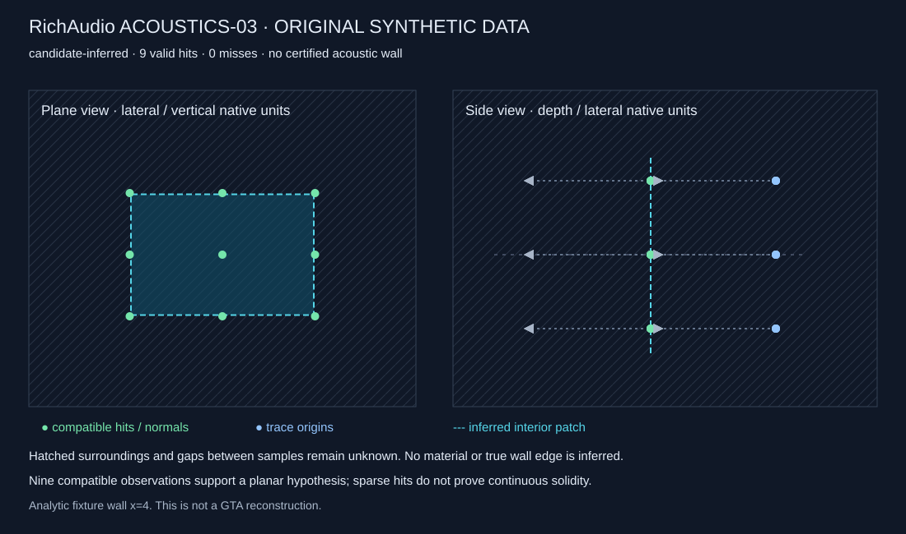
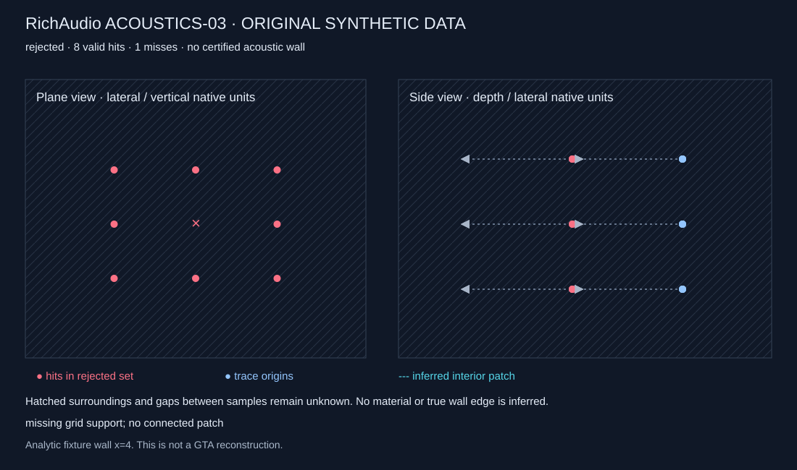

# ACOUSTICS-03: my bounded surface reconstruction experiment

26 October 2026. **PASS for one qualified, bounded GTA-derived surface candidate and verified installation restoration.** After separate approval, I've completed one Enhanced Story Mode launch and one fixed nine-ray acquisition. All nine hits pass independent readback and support an inferred planar footprint. This is diagnostic reconstruction, not certified continuous acoustic geometry, physical-unit calibration or an audible reflection. Publication/CI is reported only after final remote readback.

## Baseline and preservation

PRs #26 and #27 remain open and unmerged. My branch `research/acoustics-03-surface-reconstruction` starts at PR #27's `116166765ec7d7c40d17e52717b681986e99f098`, on the independent acoustics stream. No merge/rebase or source-synthesis ancestry is introduced. The synthesis checkout remains clean at `24e1be70eb75c8f7b43e95fe495d3c71dba5dc42`.

I've reverified **4,857 private research files and 139 link targets**, then separately fingerprinted **256 existing acoustics artifacts**, including the previous private observation, deployment/restoration evidence and built reference observer. No links are traversed. Previous source renderers, telemetry/RPM, native audio ownership, ACOUSTICS-01 mathematics and the historical one-shot adapter remain unchanged.

The previous single hit established local point/normal acquisition on Enhanced 1.0.1158.16 with RPH 1.132.1428.17748. This milestone now adds a bounded inferred surface candidate from nine new hits. Physical scale, material, permanence, actual wall perimeter and audible reflection remain unverified.

## Shutdown investigation and actual lifecycle correction

The historical [one-shot adapter](../src/acoustics/observation/GeometryObserver.Rph.cs) set READY and unconditionally called `GameFiber.Sleep(600000)`. Its capture fiber closed its record and disabled acquisition but did not end that main wait. Explicit unload interrupted the waiting task; a broad exception handler printed `NOT READY: ThreadAbortException` after FINISHED. The chronological private log and intact record establish that ordering.

The .NET Framework [ThreadAbortException contract](https://learn.microsoft.com/en-us/dotnet/api/system.threading.threadabortexception?view=netframework-4.8.1) explains automatic rethrow and finally execution during abort. This supports an expected host-cancellation interpretation; I have not inspected proprietary RPH unload internals or proved exactly which internal abort path was used.

The new separate [surface adapter](../src/acoustics/observation/SurfaceObserver.Rph.cs) uses documented [GameFiber.SleepUntil](https://docs.ragepluginhook.net/html/M_Rage_GameFiber_SleepUntil.htm), with a ten-minute **readiness** expiry and a completion/cancellation predicate. Its signature is present in the pinned authentic SDK and compilation passes. Historical documentation alone is not exact-build behaviour proof.

The predicate reads lifecycle flags only, issuing no queries. Capture closes/flushed-publishes its result before marking completion, allowing main to finish immediately after acquisition rather than lingering. Cancellation ends waiting/running acquisition; consumed claims cannot restart it. Explicit `ThreadAbortException` handling respects host cancellation without `ResetAbort` or a misleading setup-error message. This fixes the unnecessary wait, not just its logging.

[Neutral lifecycle tests](../tests/Test-SurfaceAcquisition.cs) cover claims, competing query permissions, cancellation, completion, no retry, output collisions and JSON roundtrip. A wholly owned .NET test thread independently demonstrates abort/finally semantics without RPH. At preparation, actual host completion/unload remained a live gate; its observed result is recorded below. No offline test certifies all interruption points.

Persistence reserves an attempt with `CreateNew`, writes a new `.partial` file, flushes/closes it, then moves it to the final name. On interruption, a reservation/partial may remain; neither proves a complete batch. A collision never overwrites an old record. No recovery deletes reservations or retries queries. Abrupt process/disk failure remains a limitation.

## One predetermined acquisition: nine parallel rays

Plan ID: `parallel-wall-grid-3x3-v1`. [Neutral plan and collection contract](../src/acoustics/observation/SurfaceAcquisition.cs).

- Sample one on-foot stationary player pose. No programmed player/camera movement.
- Normalised horizontal forward defines ray direction; right is `(forward.Y, -forward.X, 0)`, an explicit query basis rather than a global handedness claim.
- Origins are player position plus **1.0 native Z unit**, lateral offsets `[-0.75, 0, +0.75]`, and vertical offsets `[-0.5, 0, +0.5]`.
- All endpoints are eight native units forward from their own origins. Order is lower row left-to-right, middle row, upper row; center is zero-based order four.
- The only query is `World.TraceLine`, SDK `TraceFlags.IntersectWorld = 1`, explicitly ignoring the original player entity.
- One `RichAudioSurfaceObserve` command and durable claim; actual permission capped at **nine**, below the brief's absolute sixteen. No retry, alternate pass or pattern expansion.
- Yield once between rays. Before each, recheck Story Mode/network guards, same player handle, on-foot state, speed at most 0.25 native units/s and displacement at most 0.05 native units. Ray positions stay fixed to the initial pose.
- Check a one-second acquisition guard before each call. It cannot preempt a synchronous native call already in progress; a saved batch longer than one second fails reconstruction acceptance. This is not a hard real-time guarantee.
- Valid misses remain evidence and the predetermined plan continues. Invalid numerical/API data, cancellation, changed setup or timeout stops early. Only a complete compatible nine-hit grid can support this policy's candidate.

### Intended supervised setup

In offline Story Mode, I will stand on foot roughly **2–5 native units** from a broad, plain exterior wall, facing it approximately square-on. The wall should be visibly clear across the planned 1.5-unit lateral / 1-unit vertical footprint, with extra clearance. Avoid doors, windows, ledges, bollards in that region, moving entities, destructible panels and irregular finishes. Native units are not calibrated metres.

The location is selected and confirmed during supervised setup; no unverified world coordinates are hardcoded. The previous plain-wall arrangement is an example, not a required known location. Visual flatness does not certify collision flatness. No negative-control ray is added: the grid gives two-dimensional support and a central opening check, while original ground-truth fixtures test rejection. Nine rays cannot detect all smaller openings.

## Independent validation and deterministic reconstruction

The private `SurfaceBatch` retains schema, plan ID, ordered IDs/offsets, common session/build, initial pose, start/finish clock, actual call count, completion/error and each `GeometryObservation`. Per-ray data preserves exact query/result fields, nullable unavailable values, provenance, validation/rejection status and timestamp. Confidence stays local point/normal consistency with uncalibrated accuracy; material, extent and permanence are unknown.

The original hit validator runs in the adapter. The [independent JavaScript reconstructor](../src/acoustics/research/surface-reconstruction.mjs) recomputes segment/normal checks without trusting embedded validation flags. It verifies fixed ray geometry, IDs/order, session/build, clock order, player identity and counts. The [private inspector](../tools/Inspect-SurfaceBatch.mjs) accepts regular files below **256 KiB** under ignored `.local`, rejects linked ancestry, and writes only to a fresh private directory. Partial batches retain valid observations but cannot yield a connected polygon.

My original orthogonal least-squares implementation subtracts a nearby anchor, computes centroid and symmetric 3×3 covariance, then finds the minimum eigenvector with bounded Jacobi diagonalisation. [CGAL's PCA manual](https://doc.cgal.org/latest/Principal_component_analysis/index.html) describes this mathematical method; no CGAL code/dependency is copied or linked. Every point receives equal weight. No RANSAC, favourable-subset search or outlier removal is performed.

Rules fixed before live acquisition:

| Screen | Rule and evidence limit |
|---|---|
| Segment membership | Original `16 × 2^-23 × max(1, abs(query components))` arithmetic tolerance |
| Normal length | Original difference from unity at most 0.01; no independent sign flips |
| Coplanarity | Maximum fit residual at most `max(0.01 × 0.5, 4 × maximum query tolerance)` native units |
| Normal agreement | Every returned unit normal within five degrees of fitted normal; fit orientation aligned to first returned normal |
| Intended wall | Absolute fitted normal Z at most 0.2 |
| Rank/conditioning | Second covariance eigenvalue at least `1e-8`; second/largest variance ratio at least 0.01 |
| Identity | All available hit-handle identities agree; mixed known/unknown identities reject the joint candidate |
| Support | All nine valid planned hits required; missing cells or contradictory points/normals reject a connected patch |

The 1% planarity allowance relative to the smallest grid spacing and five-degree normal screen are explicit approximation budgets, **not measured collision-accuracy guarantees**. Arithmetic tolerance accommodates the inherited float screen. Residuals, eigenvalues/conditioning, normal disagreement, spacing and footprint inset are reported. Confidence is an ordinal evidence classification, not an invented probability. Wider spacing gives a longer orientation baseline but larger unknown gaps; neither certifies solidity. Degenerate or needle-like support fails closed.

## Finite candidate and acoustic boundary

Compatible hits are projected into an in-plane basis derived from the fixed lateral direction and fitted normal. Their convex support hull is inset by `max(2 × plane tolerance, 2 × (maximum residual + maximum query tolerance))`. The nonzero-area polygon must remain inside observed support. It is an **artificial interior footprint**, not the wall's real perimeter or building dimensions.

Candidates retain source IDs, provenance/session/build, center/normal/tangents, eigenvalues, RMS/maximum residual, normal agreement, observed hull, inset/area and bounded reuse expiry:

- **Observed:** discrete collision points and normals.
- **Inferred:** local plane and interior footprint under an explicit continuity hypothesis.
- **Unknown:** solidity between rays, sub-grid openings, true edges, complete extent, material, reflectance, permanence and physical scale.
- **Rejected:** a joint patch contradicted by missing/incompatible/degenerate measurements; no forced polygon or alternative cluster.

The candidate is `certifiedAcousticGeometry=false` in native units, with unknown material. Tests demonstrate it cannot enter the existing validated metre-coordinate acoustic tile directly. The ACOUSTICS-01 tile and solver are unchanged.

A separate diagnostic image-source calculation may use the inferred polygon with **hypothetical** source/listener positions two native units in front and 0.2 units either side of its center. It checks side and finite-polygon membership, and returns a **calculated reflection hypothesis only**. Path lengths are native units; physical arrival/delay times, pressure and energy gains are null and path visibility unknown. It certifies neither a clear path nor an audible GTA echo.

## Original synthetic evidence and visuals

[Synthetic results](research/acoustics-03/synthetic-results.json) come from [Build-SurfaceResearchExamples](../tools/Build-SurfaceResearchExamples.mjs), which accepts no live input. All six fixtures are original analytic scenes.

| Scene | Offline result |
|---|---|
| Flat wall `x=4` | Center `(4,0,1)`, normal `(-1,0,0)`, zero residual; eigenvalues `0, 1/6, 0.375`; inset area 1.4504 native units squared |
| Intersecting faces `x=4` and `x+y=4` | Normal inconsistency rejects one merged plane |
| Sampled opening | Eight valid hits and central miss; no connected candidate |
| Controlled position/normal noise | RMS 0.0007081971; max residual 0.0011111113, within fixed budget |
| Unrelated depth outlier | Nine individually valid hits; joint candidate rejected without discarding one |
| Insufficient evidence | Two preserved hits; no finite patch |

The synthetic hypothetical-endpoint path is **4.0199502484 native units**, with no physical milliseconds. A separate independently derived test checks `sqrt(36 + 0.16)` for endpoints three units from the fixture plane.





Additional original [corner](research/acoustics-03/corner.svg), [noisy](research/acoustics-03/noisy.svg), [incompatible](research/acoustics-03/incompatible.svg) and [insufficient](research/acoustics-03/insufficient.svg) diagrams are data-derived. Green hits support a candidate; pink marks a rejected set; blue marks origins; dashed cyan is inferred geometry; hatching is unknown. Height-distinct rays can overlap in the side projection. Flat/opening/corner renders were visually inspected locally. Future live diagrams stay private rather than publishing reconstructive world measurements.

## Tests and environment

I've added **63 Node reconstruction/privacy/visual tests**, **53 neutral acquisition/lifecycle assertions**, and a cross-language C#-JSON-to-JavaScript fitting check. Cases include the six scenes, analytic oblique planes/eigenvalues, translation stability, degenerate support, schema/order/budget, identity/build/session/time mismatch, invalid geometry, gaps/outliers, uncertainty, stale candidates, no certified tile promotion, hypothetical reflections, deterministic output, path/link/size guards, cancellation and output collisions.

Authentic-SDK compilation passes against SDK 1.124.1393.17586, SHA `5D439745604A5FEDBF8FA401520D4F296C1B6800D77E2923BA3BF9772182C7E0`. The full local suite passes: 17 metadata tests, 40 ACOUSTICS-01 tests, 73 ACOUSTICS-02 assertions, the 63 new Node tests and 53 new acquisition assertions/cross-language check, **110 repository checks**, 65 telemetry assertions, nine configuration checks and eight append expectations. Hosted tests need no proprietary SDK/game files. Hosted CI is recorded only after actual readback, never inferred from local compilation.

No dependency is added. Local visual QA used the existing bundled image renderer; no third-party tools are distributed. Project licensing is undecided; our algorithms/tests are original and proprietary SDK/runtime components remain local dependencies.

## Fresh installation preflight and sealed preparation plan

I've freshly measured **32 root-file SHA-256 records, root directories, 179 archive metadata records and ten sampled archive hash calculations**. They match historical evidence. Both original executable signatures are valid; Enhanced remains 1.0.1158.16 and authentic RPH 1.132.1428.17748. Runtime/loader/fix sources and independent obsolete-executable backup match their pins. No relevant runtime/editing/ProcMon process, PROCMON25, alias or destination conflict is present.

The new private seal specifies **27 additions**: the same 25 approved runtime/loader/fix files plus `Plugins/RichAudio.Surface.Rph.dll` and private config. No historical observer or telemetry plugin runs. The temporary obsolete-executable filename change is retained; original contents are never edited and no existing file is overwritten.

Observer SHA: `C3F84AE91653AD88B871BAA9ECD091D4208465D12D72ACC95A6A95AC2C46DF8A`.

Private manifest SHA: `21F5639DE91DE8482374596C99A6F6BFE86CCABE5D87628BA90AD488957DCFAC`.

The private Verify/Begin/Restore helper retains the previously verified procedure with a new seal, observer allowlist, nine-query limit and fingerprints of the **fresh** baseline files. At the sealed checkpoint, read-only Verify passed and Begin had not run. The subsequent separate approval and actual deployment are recorded below. Sources, baselines, signatures, absent paths, processes and diagnostic cleanup were rechecked immediately before mutation. Every change was journalled first; unexpected content would be preserved and block cleanup PASS.

The rollback plan required observing completion/unload/normal quit, preserving private evidence, quarantining exact temporary additions outside the game, restoring names and independently checking the fresh hash/signature/directory/archive comparisons. Recognised generated files and the fingerprinted empty code template follow the existing narrow procedure; unknown data is not deleted. Preparation alone did not establish restoration; the actual post-test receipt is summarised below.

The single launch reused validated `-forcesettings -log` and the established offline Story Mode configuration, with autoload disabled. No guessed flags, security changes, unrelated plugin, dependency installation, audio command or world mutation occurred. No recovery retry was made.

## Reproduction and privacy

From the repository root, offline:

```powershell
./tools/Test-Offline.ps1
./tools/Build-SurfaceObserver.ps1 -SdkPath $authenticPinnedSdk
node tools/Build-SurfaceResearchExamples.mjs .local/fresh-synthetic-examples
```

After a separately approved acquisition, inspect the closed private batch:

```powershell
node tools/Inspect-SurfaceBatch.mjs .local/acoustics03-runtime/observations/surface-batch.json .local/fresh-surface-diagnostics
```

The output directory must be new with an existing parent. Private diagnostics include a fitted record, optional hypothetical path and SVG; console output is scalar-only. Setup failure without valid pose retains its rejection without an invented view. `.attempt`/`.partial` alone is incomplete evidence. Raw live measurements, sessions, screenshots, logs, installation paths, binaries and assets stay out of Git. Public figures come only from original fixtures. No project licence is selected.

## Approval checkpoint

The communicated checkpoints are **0 → 10 → 25 → 50%**. The first three weighted stages are complete. Weights remain repository 10%, investigation/safety 15%, implementation/tests 25%, supervised acquisition 20%, live validation/restoration/performance 15%, final documentation/publication 15%. A prepared draft PR/CI check does not award the final stage before actual live findings and restoration are documented.

| Gate | Status |
|---|---|
| Repository/ancestry, source review and preservation | PASS |
| Lifecycle correction and original neutral tests | PASS offline; host completion/unload NOT TESTED |
| Fixed plan, synthetic reconstruction, adapter build | PASS offline |
| Fresh installation / restoration readiness | PASS read-only |
| Separate ACOUSTICS-03 live approval | PENDING |
| New live surface and performance | NOT TESTED |
| New normal quit / restoration | NOT TESTED; installation unchanged |
| Scientific outcome | PENDING; no new real GTA surface claim |

This table records the **historical prepared checkpoint** at commit `e328c3c73f86d768d305584fba3e1ce637233e2b`. I subsequently received the explicit reply, "Go ahead with the one supervised test". The result below supersedes its pending live statuses. No earlier milestone's approval was reused.

## Actual supervised experiment

I've used the established offline launch configuration unchanged, confirmed correct Enhanced 1.0.1158.16/RPH 1.132.1428.17748, DirectStorageFix 1.2 initialisation and disabled plugin autoload. The existing offline launch option was independently verified in the actual game process; no security setting was changed. The 27 sealed source/deployed hashes matched. I loaded the new observer exactly once, verified READY without queries, then entered `RichAudioSurfaceObserve` once.

My setup description was: "this is the best I can do, its a big brick wall just off one of the main roads in vinewood". The supervised view showed a broad plain masonry-looking wall, no opening or moving object in the intended region, and low vegetation/litter at the base. I was on foot; all nine recorded speed readings were zero. Visual appearance supports target identification but does not establish collision topology or acoustic material. The target was not selected by searching results from multiple acquisitions.

The fixed row-major nine-query plan completed with nine finite, on-segment hits and no misses, invalid records, changed player identity, retries or extra queries. No thresholds, offsets, lengths or fit policy changed after viewing the result. The private reservation and closed final file exist, no `.partial` file remains, and the raw record fingerprint stayed unchanged through shutdown and restoration.

### Geometry result

| Measurement | Actual result |
|---|---|
| Planned / completed / valid / compatible hits | 9 / 9 / 9 / 9 |
| Missing or contradictory observations | 0 in this grid; sub-grid gaps remain unobserved |
| Fit RMS | 0.000006829375577 native units |
| Maximum orthogonal fit residual | 0.000009658195581 native units |
| Predetermined residual allowance | 0.005 native units |
| Maximum returned-normal/fitted-normal angle | 0.0003271346002 degrees |
| Independent three-corner plane maximum residual | 0.00001448729335 native units, below the same allowance |
| Independent plane/TLS angle | Rounds to zero at reported double precision; not proof of exact equality |
| Artificial footprint inset | 0.01 native units |
| Candidate lateral / vertical span | 1.4803587662 / 0.98 native units |
| Candidate footprint area | 1.4507515909 native units squared |
| Hit entity | None returned on all nine; static permanence remains unverified |
| Material / real wall extent / physical scale | Unknown / unknown / unverified |

The independent check forms a plane through the lower-left, lower-right and upper-left hits using a cross product, then checks every saved hit against it. This is separate from the least-squares eigensolver and adds no game query. Small numerical residuals demonstrate consistency of this sample, not a calibrated physical accuracy guarantee.

My candidate retains all nine observations, the fitted plane and inset polygon with explicit inferred continuity and unknown true edges. It remains outside the validated acoustic tile. The native-unit point mapping is locally consistent; one batch does not establish complete scale, handedness or every global coordinate convention. No unobserved region is labelled clear/solid.

The private diagnostic image-source calculation, using the predetermined hypothetical offsets around the inferred patch, yields a **4.0199502484-native-unit path hypothesis**. Its physical arrival/delay, material and usable acoustic gains remain null, and both legs have unknown world visibility. It is not a measured or heard echo, or a certified reflection from a real building. I did not call the validated metre-coordinate solver with this candidate.

### Visual evidence and privacy

The saved nine-hit dataset generates a private plane/side-view diagram showing query origins/directions, hit positions/normals, inferred interior and unknown surroundings. It was rendered and visually inspected locally. The live dataset, reconstructed polygon/plane coordinates and actual diagram remain ignored/private; only a [non-reconstructive scalar summary](../evidence/acoustics-03-surface-summary.json) is public. The diagrams earlier in this document remain wholly original synthetic examples, not substitutes presented as actual GTA evidence.

### Performance from this one batch

Combined synchronous trace durations in acquisition order were **1.3205, 0.0579, 0.0748, 0.0533, 0.0588, 0.0688, 0.0660, 0.0543 and 0.0516 ms** (sum 1.8060 ms). Result conversion summed to 0.0822 ms; in-game validation to 7.0128 ms. Start-to-finish acquisition time was **107.2195 ms**, including guards, validation and inter-ray frame yields, but excluding final JSON publication. Individual dispatch/completion cannot be separated through this wrapper; final write cost was not measured.

Independent offline readback/validation/fitting took **1.85 ms** in its first recorded analysis. The in-game managed-heap snapshot was 112,949,176 bytes, not incremental observer allocation or total game memory. The first inspector process reported RSS 39,051,264 bytes; that is a process snapshot, not fit-only memory. The cold first call and later calls are not equivalent timing conditions. No repeated in-game benchmark, linear-scaling extrapolation or real-time/audio-thread certification is claimed. Reconstruction runs offline, outside any audio callback.

## Lifecycle and restoration actually observed

The log records FINISHED with nine calls, then **"lifecycle ended; no further queries" about 3 ms later**. The previous ten-minute post-result wait did not remain. I issued one explicit unload request afterwards; RPH recorded the unload-all request, without the previous `ThreadAbortException` or misleading setup warning. No separate plugin-unloaded confirmation line was emitted, so I do not use that request alone as proof of AppDomain teardown. Normal game-process exit closes that runtime boundary. This is one successful lifecycle observation, not proof against every possible host termination.

I've closed the console, used normal GTA Quit and accepted its confirmation. No process was force-killed. Before restoration GTA, RPH and PlayGTAV were absent. The journalled helper preserved/quarantined all temporary additions and recognised generated files outside the game, restored the obsolete executable name and verified against the fresh baseline:

- Both original executable hashes/signatures: valid and unchanged.
- All 32 root-file hashes and the exact root-directory set: match.
- All 179 archive metadata records and ten sampled archive hashes: match.
- All 27 temporary paths, alias and unexpected generated additions: absent.
- Relevant runtime/editing/diagnostic processes and PROCMON25 filter: absent.
- Protected 4,857 private files, 139 links and 256 prior acoustics artifacts: unchanged; source-synthesis checkout clean at the original commit.

No diagnostic driver was installed during this test. No original executable contents, archives, game audio, accepted source synthesis, telemetry/RPM or reflection mathematics changed. Normal game save/profile activity outside the installation is not covered by an installation-hash restoration claim.

## Completion interpretation

My actual communicated checkpoints are **0 → 10 → 25 → 50 → 70 → 85%**. Stages one through five are complete. The final 15% remains conditional on result documentation, publication screening, exact remote PR/commit readback and completed hosted CI; a previous prepared-commit CI run does not certify this later result commit.

**Scientific outcome: PASS for a clearly qualified bounded reconstruction**, supported by consistent real GTA observations and independently verified restoration. Continuous solidity, actual wall edges, complete material/scale mapping, authoritative acoustic ingestion, real reflections, automatic nearby mapping and audio remain unproven.

**My one next proposed milestone:** separately authorised, bounded discovery and maintenance of several nearby surface candidates in a small diagnostic acoustic tile, preserving unknown coverage, identities and invalidation. This does not authorise a city scanner or certified reflections from inferred geometry. I have not begun that expansion or any sound output.
