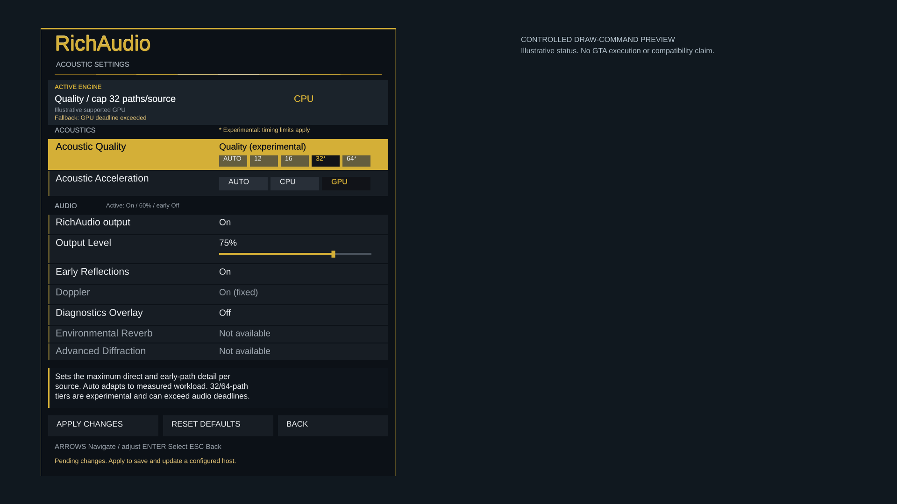

# RichAudio in-game settings — ACOUSTICS-08.2 extension

The combined RPH bridge now contains a separate, gold-branded **Story Mode settings overlay**. This is **not** an added stock Pause Menu → Settings category. Changes reach the existing persistent configuration, Windows host, simulation worker, CPU/GPU selection and streaming renderer. No game launch, deployment, audio endpoint, dependency installation or system change was used to implement it.

## Supported route and compatibility evidence

The exact target remains GTA V Enhanced **1.0.1158.16** and RPH **1.132.1428.17748**. The adapter retains its exact-build guard. Static metadata inspection and compilation used the authentic private SDK pinned by SHA-256 `5D439745604A5FEDBF8FA401520D4F296C1B6800D77E2923BA3BF9772182C7E0`; the SDK was neither executed nor redistributed.

No supported category-insertion interface was identified in that SDK or publisher documentation. This is a bounded finding, not proof that no conceivable insertion is possible. The implementation does not patch memory, replace the frontend, modify GTA Online or install graphics hooks. It uses the SDK's public `RawFrameRender` event and graphics primitives for a separate overlay.

The [publisher's rendering guidance](https://docs.ragepluginhook.net/html/Events_T_Rage_Game.htm) warns that natives in `RawFrameRender` can crash. The drawing callback therefore consumes an immutable frame of rectangles/text only. Input, active-player checks and frame-scoped input suppression run on an owned game fiber. File reads, mutex work, saves and status polling run on one background worker. No menu operation runs on WASAPI's callback.

The public documentation is old, preliminary guidance; presence of the APIs in the exact authentic SDK was separately verified. Compilation establishes API availability, not live Enhanced compatibility. Mouse-state coordinate semantics and text-size units are not fully documented. The adapter uses normalized cursor input rather than assuming desktop/client mouse coordinates; actual cursor placement, font sizing and interaction still need in-game verification.

[LemonUI supports RPH generally](https://github.com/LemonUIbyLemon/LemonUI), but its [Enhanced support issue](https://github.com/LemonUIbyLemon/LemonUI/issues/219) remains open/blocked. No compatibility proof for this exact RPH/Enhanced pair was established, so no LemonUI dependency was introduced.

## Opening and interaction

- Default **F10**, configurable to F1–F12 except RPH's reserved F4 through the private menu sidecar.
- RPH console command **`RichAudioSettings`**. The request waits until the console closes; it starts no host, beacon or publisher.
- Controller **LB + D-pad Right**, with D-pad navigation, A select and B back. Controller access can be disabled in the sidecar.
- Keyboard arrows, Enter and Escape; mouse hover, clicks, wheel navigation and output-level selection.

Opening consumes the shortcut without immediately adjusting a setting. Directional repeat is bounded, Accept/Back are edge-triggered, and navigation must release after opening. Hidden menus do not suppress gameplay. Closing consumes its final Back input and releases suppression on subsequent frames. Opening the stock pause menu, loading, opening the RPH console, losing an active player or entering a network session closes the overlay. The plugin never sets pause/unpause state. Its raw-drawing handler is detached on unload; the fiber ends at its next yield and the background worker is stopped off-fiber.

The visual layout uses translucent dark panels, `#D4AF37` gold, subtle title highlights, an output slider, five quality positions, a separate acceleration selector, contextual descriptions and clear unavailable/experimental labels. Cached rendering contains no native calls or IO. Controlled previews use actual menu drawing commands and illustrative status, not GTA screenshots. Layout checks cover 800×600, 1280×720, 1920×1080 and 3440×1440.

## Operational controls

| Control | Actual behavior |
|---|---|
| Acoustic Quality | Auto / Performance / Balanced / Quality / Max select adaptive or 12/16/32/64 total direct-plus-early contribution ceilings. Solver selection and renderer capacity change. 32/64 are explicitly experimental because measured demanding scenes miss deadlines. |
| Acoustic Acceleration | Auto / CPU / GPU reach the real backend independently of quality. Fresh actual backend, device and CPU fallback reason are displayed. GPU status requires completed hardware acoustic results; a requested selector is insufficient. |
| RichAudio output | Smoothly attenuates or restores only RichAudio-owned output. It does not issue Start/Stop, establish a publisher connection, start a host or alter GTA sound. Source history keeps advancing while muted. |
| Output Level | 0–100% attenuation of the existing reviewed profile, with a 20 ms smoothing time constant. It cannot boost above the profile or alter direct/reflected gain relationships. |
| Early Reflections | Off skips reflected candidate calculations, keeps valid direct/obstructed propagation, and lets old reflections fade through existing release banks. On restores valid first-/second-order work without source resets. |
| Diagnostics Overlay | Enables a compact, noninteractive report while the settings screen is closed. Unavailable/stale engine state is labelled as such. |
| Reset Defaults | Selects Auto/Auto, output enabled at 100%, early reflections on, diagnostics off; Apply persists normal changes. Explicit recovery of malformed supported preferences preserves their original bytes before resetting. |

**Doppler is active but read-only.** Its pitch/time behavior is coupled to the causal propagation cursor; an independent, phase-safe bypass is not implemented. Changing only a rate field would not honestly disable it. Environmental late reverberation and advanced diffraction remain unavailable, and are labelled accordingly. Separate direct/reflection level knobs are not exposed because an independent gain model has not been validated.

Path budgets are ceilings, not guaranteed audible path counts. The existing two-bounce model and finite observed coverage remain limiting factors. The [multiple-path and environmental late-field architectural requirement](../ARCHITECTURE.md#governing-acoustic-requirement--29-october-2026) remains intact.

## Persistence and application

The future plugin folder contains a dedicated **`RichAudio.Menu.json`** connection sidecar. Its five fields are `schemaVersion`, `workspaceRoot`, `settingsPath`, `toggleKey` and `controllerEnabled`. It points to a fixed local workspace and private `.local/acoustic-settings.json`; it never edits GTA's settings files. Paths cannot be remote, linked or outside the private configuration scope. Only one reviewed workspace/file binding is accepted during a plugin lifetime.

`Build-BeaconBridge.ps1 -SdkPath <authentic-private-SDK>` compiles the new combined plugin and prepares this sidecar in the private build output. It performs no installation. Existing sidecars are preserved. The existing sealed candidates and 26-file deployment manifest are unchanged; any later live package must separately bind the changed plugin and new sidecar before approval.

Schema-version-1 preferences remain backward compatible: old quality/acceleration-only files acquire sensible audio defaults. Unknown fields, unsupported values, invalid booleans and output levels outside 0–1 are rejected. The background bridge uses one bounded command mailbox, 250 ms polling, atomic file publication, increasing revisions and compare-and-swap protection against concurrent editors. Saves remain available with no host running and do not launch one.

A configured host's existing monitor forwards accepted revisions through its control queue to the actual Node worker. Its confirmed processing settings then reach the renderer. No source ring is recreated, no audio buffer is enlarged, and no GPU work occurs on an audio callback. Saving during an unconfigured legacy host session requires a later configured host startup; the menu states that requirement rather than pretending a live change succeeded.

Pending edits, saved preferences and fresh actual processing are distinct. The active engine box reports measured quality/backend; the Audio section separately reports fresh applied output/level/reflection state. Stopped, stale, absent or invalid status cannot establish GPU activity. GPU unavailability leaves CPU controls usable. Concurrent edits are retained and reported instead of silently overwritten.

Malformed supported preferences can be explicitly reset inside the menu: the background worker binds their exact observed hash, rechecks it under the current-user mutex, preserves the original in a unique sibling `.invalid-<guid>.json`, then creates defaults. A concurrent replacement aborts recovery. Future-schema, oversized, linked and unrelated configurations stay preserved and unavailable. No generic quarantine or launch infrastructure is added.

## Verification and remaining work

`./tools/Test-InGameMenu.ps1` tests the actual menu model, pointer hit regions, keyboard/controller routing, pause/loading/console guards, stale/unsupported status, GPU proof checks and bounded multi-resolution draw output. Its software previews are private authored artifacts. `./tools/Build-AcousticSettings.ps1 -Tests` checks the real persistence/background bridge, including revision conflicts and reset recovery. `./tools/Test-AcousticSettingsHandoff.ps1` exercises the actual settings path to host/worker/PCM without constructing an audio device. `node --test tests/Test-InGameAcousticControls.mjs` checks real solver bypass, smooth output changes, mute/re-enable, continuity and history preservation. All are registered in the required offline suite.

The existing CPU/GPU PCM and transport regressions remain in place. GPU computation, vendor-neutral fallback, quality timing limitations and the first hosted software-classification correction remain recorded in the [GPU report](ACOUSTICS_08_2_GPU_ACCELERATION.md). Final test counts, sanitized evidence and hosted CI apply to the final published PR contents, not an assumed future game build.

The local required suite passed 431 Node cases with zero failures, plus 960 menu/input/status/layout checks. Final focused validation passed 44 existing settings checks and 59 background-bridge checks after concurrency/recovery corrections. The actual menu → persistence → host → worker handoff produced 390 PCM blocks: one source identity, valid direct-only processing with reflections disabled, 12 measured fully muted blocks, resumed nonzero PCM, and zero ring underflows, rejected blocks, limiter events or cursor resets. These are device-free fixture results; they do not establish endpoint reliability or subjective sound. [Sanitized evidence](../evidence/acoustics-08-2-menu/result.json) retains the measured values. Final hosted CI status and its exact head/tree are recorded in the draft PR.

Still unverified: actual overlay drawing and font metrics in Enhanced, normalized cursor behavior, controller conflicts, console/pause transitions and unload under GTA load. A later separately approved installation/Story Mode test must verify these with the newly bound files. This task grants no live authorization. The original CI failure cause remains unknown; 07.9 remains incomplete with failed Stop timing, 07.13 failed at launch, and the combined milestone remains **60%**.
