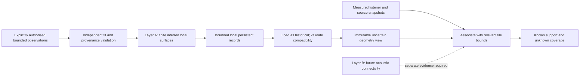

# Installation-aware acoustic mapping: bounded cache foundation

Reviewed 27 October 2026. **OFFLINE TESTED on original synthetic fixtures.** No installation-aware live mapper, startup scan or city database exists. The combined [milestone report](ACOUSTICS_05_BENCHMARK_01.md) records the independent live gates and negative small-fixture timing result.

## Two layers, with explicit gaps

Layer A retains finite patches, normals, support footprints, observation provenance and uncertainty. It cannot establish openings, solidity between rays, material, destructible-state permanence or unstreamed geometry. Layer B will describe acoustically justified connections between streets, tunnels, barriers and passages at lower detail. It is a separate representation, not a road-navigation graph repurposed as sound propagation. Its current contract accepts only empty nodes/links with unknown coverage; no city connections are invented from two patches.

Source/listener positions can later select nearby tiles using their bounded extents. A local listener tile does not represent the space between a distant motorcycle and Legion Square. Missing tiles and unknown connectivity remain coverage gaps. The vehicle benchmark must operate independently of cache availability; it cannot manufacture a sound path from its driving checkpoints.

## Identity and compatibility

`world-cache-format.mjs` defines version 1 with:

| Field | Contract |
|---|---|
| Build/schema/algorithm | Enhanced `1.0.1158.16`, schema 1, `orthogonal-plane-jacobi-v1`; unsupported versions reject |
| Coordinates | `gta-native-units-unverified`; no automatic conversion to metres |
| Environment/interior/map family | Bounded local identifiers; different identities invalidate reuse |
| Resource evidence | At most 32 identifiers, SHA-256 fingerprints and declared affected tile IDs, or unknown/global scope |
| Completeness | `partial-runtime` for real installations; `synthetic-complete` reserved for declared synthetic worlds |

The prototype takes a caller-supplied identity. **It does not discover installed map mods.** No installation paths, account names, complete game hashes or personal machine identifiers are collected. All storage remains local. Matching the game version, filenames or resource fingerprints is insufficient to prove the installed world is unchanged. Matching real identities therefore remain **uncertain**, even when every supplied field matches.

Changes in a known tile-scoped resource invalidate affected records. Declared unrelated synthetic tiles remain reusable as historical data. An unknown/global resource change conservatively invalidates candidate records throughout that world identity. An unmanifested real-world change cannot be detected by this prototype; it stays uncertain rather than becoming authoritative. Resource-array ordering can create distinct equivalent keys: safe duplication is preferred to an unproven normalization rule in this research version.

Future identity discovery needs evidence about effective resources, placement overrides, interiors and streaming generations, not simply mod directory names. A reliable affected-region relationship is required before localized invalidation can be claimed for real map modifications.

## Versioned tile format

An immutable `.ratile` file contains four bounded ASCII header lines followed by canonical UTF-8 JSON:

1. Magic `RichAudio-Acoustic-Tile`.
2. Envelope version `1`.
3. SHA-256 of the exact JSON bytes.
4. Exact payload byte length.

The checksum detects corruption, not malicious authorship. The content-derived filename also binds world identity, tile ID and payload. Strict JSON/schema validation still runs after checksum validation.

| Tile data | Meaning and bounds |
|---|---|
| ID, world, saved UTC, bounds | Local identity; each extent positive and at most 32 native units |
| Groups | 1–4 explicit nine-observation groups; session/generation/interior, acquisition time, source fingerprint, wall/ground kind |
| Streaming generation | Explicitly unavailable; no persistent-world certainty inferred |
| Patches | One inferred patch per group; bounded center/unit normal, 3–9 convex finite-support vertices, residual/RMS/normal screens |
| Fit rule | Stored arithmetic tolerance preserves `max(0.005, 4 × arithmeticTolerance)`; loading cannot widen the original rule |
| Source IDs | Nine unique expected IDs tied to the named observation group |
| Unknowns | Between-ray solidity and beyond-support regions remain unknown |
| Material/permanence | `unknown` / `unverified` |
| Wider connectivity | Null; future separate contract only |

Actual original observation data stays in private acquisition records. The cache contains derived support plus a fingerprint, not an independently auditable substitute for the raw evidence. Its geometry cannot be authenticated against missing raw observations merely by checking its own checksum. No raw geometry cache is a public release asset.

### Knowledge and compatibility are separate

| Term | Interpretation |
|---|---|
| Observed | A supported method returned actual measurements in the source acquisition record |
| Inferred | A bounded reconstruction hypothesis derived from those observations |
| Historical | Previously observed/inferred data, not revalidated in the present world state |
| Invalid | Detected incompatibility means the record must not support current acoustic claims |
| Unknown | Insufficient coverage, semantics or world evidence |

`loadedView` always returns immutable `knowledge: historical` or `invalid`, `basis: inferred`, `current: false`, `authoritative: false`, and `observationScheduling: none`. Even a synthetic `compatible-declared` match never promotes cached geometry. The exact stored uncertainty and provenance survive roundtrip. Real-world revalidation is a separately authorized future operation; age expiry does not cause reacquisition.

## Storage and thread safety

`world-cache-build.mjs` is the explicit fit/export path. The loader does not import it or call reconstruction, collision, game, audio or executable-deserialization APIs. Loading a tile performs **zero collision scans and zero fitting calls**.

Defaults: 256 KiB per file, 16 directory entries, 4 MiB aggregate disk budget, four resident tile views. Configuration is bounded to at most 64 entries, 16 MiB and 16 resident views. JSON nesting is capped at 16; identifiers, arrays, fields, floats, normals, fit limits and footprints are checked. Unsupported, corrupt, incomplete, oversized or hostile documents return missing/rejected/incompatible status. No script/function/plugin content is evaluated. Public and linked paths are rejected, including broken links.

Publication uses an exclusive new `.pending` file, flush, then same-filesystem atomic no-replace hard-link publication. The temporary link is removed only after success. Interrupted files are retained as pending and never treated as usable tiles. Quotas count pending and corrupt entries; a full directory rejects writes instead of deleting older evidence. No power-loss durability guarantee is asserted for every filesystem. Unsupported hard-link publication fails without replacing an existing tile. Concurrent external filesystem mutation is outside this trusted-local research prototype's security boundary; prechecks are not a race-proof security sandbox.

Disk operations are synchronous **offline research only**. They must never run on an audio callback or game render callback. A future implementation requires a bounded IO worker, immutable publication and explicit cancellation. The resident LRU bounds views retained by the store, not copies retained by callers. Directory/path checks are repeated on loads and contribute measurable overhead. No optimization or city-scale performance claim is made here.

## Future incremental mapping contract

On a future visit: identify the environment using available supported evidence, discover a bounded set of candidate local records, load relevant records as historical, reject demonstrated incompatibility and operate with explicit gaps. Never wait for a city survey before making Story Mode playable. No loading/drawing/replay path may schedule acquisition.

Before any background mapping can be considered, separately prove streaming/collision coverage, scene stability, supported scheduling, material limitations, bounded query/time budgets, cancellation, affected-region invalidation, persistence crash recovery, and measured game-frame/IO/memory costs. Automatic scanning remains unauthorized.

For eventual larger worlds, use a coarse spatial key and small bounded metadata index to locate disk tiles, with a near-region LRU and independently resident connectivity chunks. Do not load a city's geometry into RAM because it exists on disk. Index transactions, quotas/eviction, neighbor seams and uncertain resource scopes require their own tests. The current store uses explicit content keys and a tiny bounded directory; it is **not** a city-scale spatial database.

## Reproduction and acceptance

Run `tools/Test-Offline.ps1` for the original synthetic suite. Run `node tools/Measure-WorldCache.mjs .local/fresh-cache-measurement` only with a fresh private output directory. It records reconstruction versus guarded cached-load costs, alternating execution order. Neither command launches GTA or reads its archives.

Ten synthetic map scenarios cover unchanged geometry, added/removed buildings, new tunnel, road elevation, replacement map, new interior, unmanifested change uncertainty, unverified dynamic permanence and visual geometry without collision support. Tests also cover corruption, interrupted writes, checksummed hostile input, quotas, LRU, private paths, immutable uncertainty and forbidden promotion.

**Cache foundation: PASS OFFLINE.** Roundtrip/rejection/uncertainty/no-query/reconstruction-avoidance criteria pass. **Speed improvement: NOT DEMONSTRATED.** The measured tiny cached path is slower; see the scalar benchmark and milestone report. No new in-game geometry acquisition, cache revalidation, startup improvement, full mod detection or city mapping is established.
