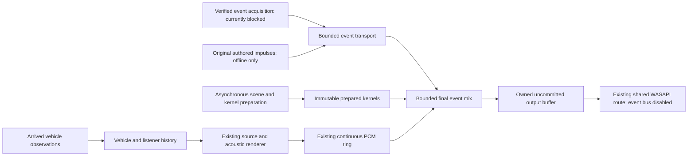

# LATENCY-02: separate timing for continuous sound and transients

I have an executable **offline synthetic-event prototype**, separate from my continuous vehicle policy. A transient does not wait for 75–100 ms of listener history or enter the vehicle PCM FIFO. Codex implemented prewarmed acoustic kernels and a bounded late-mixing stage, and tested them without opening an endpoint. My existing live route passes a literal null event bus and retains its defaults.

This is not a live weapon implementation. Supported acquisition of complete timestamped GTA muzzle events, selective native ownership/restoration, moving-event geometry and actual endpoint presentation-clock mapping remain unqualified. GTA's existing gunshots remain operational; no RichAudio muzzle blast is added to them.

## Four timing contracts

| Path | Selection and timing | What must remain true |
| --- | --- | --- |
| Engine/exhaust operating state | Existing default selects 100 ms retrospective state; the reviewed opt-in selects 75 ms. A new constructor-only stationary experiment selects an arrived authored state at the current dry-PCM emission frame. | No future observation, backdated dry emission, identity change, expired lease or fabricated moving pose. Phase/grain history, source smoothing and calibration remain unchanged. |
| Listener/camera/Doppler | Its own genuine observation history, piecewise generations and unchanged discontinuity/expiry guards. | A faster operating update does not make a stale moving pose valid. Invalid camera reconstruction is not accepted by increasing the speed limit. |
| Discrete event | An occurrence interval, observation receipt and explicit clock uncertainty identify one event. A prewarmed source reaches the earliest still-writable output region consistent with its physical travel time. | Exact session/source/generation/sequence, bounded age, finite voice/queue budgets and a verified clock map. Late output is reported or rejected; its occurrence is never rewritten. |
| Acoustic scene/reflections | The last qualified prepared scene/kernel is usable while a worker prepares a replacement. Each prepared path carries its own geometric travel distance. | Loading, extraction, cache IO and heavy path solving stay outside the audio callback. Missing geometry remains conditional/unknown. Invalid generations/poses cannot borrow an unrelated prepared kernel. |

The same existing acoustic renderer implementation prepares every kernel. `CausalSimulation` and `StreamingRenderer` run in separate preparation instances; the native stage only adds those already rendered samples. It is not another geometry solver or acoustic engine. Real-time moving listeners and dynamically changing reflection solutions are future work, not something the fixed-pose kernel bank proves.

## Event acquisition and coexistence

Codex checked the existing native/RPH research, the actual reference SDK metadata and pinned primary native/framework sources. `IS_PED_SHOOTING` is a boolean polling observation. `GET_PED_LAST_WEAPON_IMPACT_COORD` supplies a last impact coordinate, not a complete timestamped shot sequence. Generic script-event queues do not establish a stable muzzle-event schema or a sample-clock timestamp. RPH's ped-shot notifications describe a ped being hit, not every muzzle discharge, miss, explosion or impact; their payload lacks the required occurrence timestamp and the reference/runtime versions differ.

The [source-capability report](LATENCY_02_SOURCE_EVENT_CAPABILITIES.md) separates an occurrence interval from the bracket around acquiring an observation. A function returning successfully is not timestamp or multiplicity proof. The production capability registry is immutable and blocked; caller-supplied claims cannot enable it. Only branded original authored impulses can enter the fixture path.

Direct weapon replacement remains gated on verified suppression and restoration, as in [native vehicle ownership](NATIVE_AUDIO_OWNERSHIP_01.md). A future reflection-only adjunct would also need a verified native/direct separation and attribution contract. It is not silently enabled as a workaround for duplicate muzzle sound.

## Executable bounded prototype

The dedicated owned Node child emits a fixed 144-byte `RAE2` descriptor on a stream separate from `RA07` continuous PCM and its credits. It retains session, source/scene/listener generations, zero-based sequence, lifetime event identity, occurrence bounds, acquisition bracket, observation receipt and explicit clock uncertainty. The native ingress worker validates and maps these fields before publication.

Eight immutable original kernel slots hold at most 24,000 stereo frames each. The actual prepared payload is 524,288 bytes. The native bus has 32 voices, two 64-entry descriptor lanes and at most 8,192 unique event IDs per session. Normal-priority sound can occupy 24 voices, reserving eight for high priority. A high-priority arrival may retire a low-priority voice, truncating that tail; exhausted high-priority capacity still rejects events. This explicit overload trade-off is not a smooth production voice-stealing policy. Neither polyphony nor bandwidth is unlimited.

The separate stream avoids waiting for vehicle PCM credits. Priority applies **after decoding**: a high-priority descriptor cannot overtake older bytes already serialized onto the same FIFO pipe. Node's bounded buffer pool and actual write completion retain buffer ownership under backpressure. The [prepared-transient report](LATENCY_02_PREPARED_TRANSIENTS.md) records the exercised pool-pressure case and finite kernel-tail limits.

`OwnedPcmSubmission.Fill` first obtains the unchanged continuous samples, then optionally mixes synthetic events into that owned buffer. The real `WasapiOutput` supplies null, so it creates no event source, worker or queue. In the fixture, event admission never edits queued continuous PCM or refills its ring. If continuous underflow occurs, event output is cancelled; it cannot hide starvation.

The callback has preallocated queues, voices and receipt storage. It performs bounded validation/mixing and atomic publication, without worker waits, file IO, logging, source loading or geometry calculation. Kernel registration/cloning, hashing, JSON/wire decoding, clock setup and cleanup occur outside it. The functional IL check covers the explicitly listed application callback helpers; it is not a proof about every BCL/JIT implementation. Allocation counters separately measure the tested `Fill`/mix region.

The declared continuous peak budget remains 0.95. Original synthetic kernels are at most 0.001 peak per voice; 32 coherent voices fit a 0.032 event budget without changing Bati gain or adding a limiter. An undeclared continuous headroom breach disables the event bus while preserving continuous samples. This amplitude is a safety fixture choice, not weapon loudness calibration or a claim of physically calibrated power.

## Clock mapping, propagation and lateness

The prototype has an explicitly **authored presentation epoch**, not an inferred real endpoint clock. C# maps the latest possible occurrence plus declared uncertainty to a conservative emission frame. Each kernel already includes direct propagation and reflected path delays from the existing solver. They are not added a second time by the mixer.

The prepared direct distance of 3.43 authored metres corresponds to 480 frames at 48 kHz/343 m/s. Wall and passage reflections use their longer image-path distances, rather than a repeated arbitrary echo. The fractional interpolator's exact first nonzero sample is checked against the analytic direct distance; a conservative integer guard shifts the whole kernel if needed. Extra clock uncertainty also shifts the whole kernel once. It does not trim or move reflections independently.

Already committed samples cannot be changed. An event whose physically ideal onset has passed may shift as a whole to the first uncommitted sample, with explicit common software lateness, or be rejected once its permitted lateness is exceeded. Its event timestamp and relative path delays stay intact. Submission of a future sample is distinct from presentation of that sample: a small observation-to-submission number is not an equally small audible response.

Before real endpoint use, a separate reviewed adapter must bind `IAudioClock`, QPC, padding, first writable frame, initialization/start phase and uncertainty. `GetPosition` returns its associated QPC position in 100 ns units; it must not be compared as if it were raw `Stopwatch` ticks. Neither the first `ReleaseBuffer` nor a nominal buffer size establishes that map by itself. The current prototype deliberately supplies no such live map.

`Cancel` closes admission and requests retirement. It is not completed silence. The owner must join its producer/consumer, then obtain successful off-callback `FinishCancellation`; in-flight admission or an owned callback prevents a false completion acknowledgement. Receipt access returns a value snapshot. Timing analysis reads receipts after joining, rather than treating a concurrent snapshot as an atomic multi-field journal.

## Avoidable and remaining delay

| Contribution | Current assessment |
| --- | --- |
| 100/75 ms retrospective control selection | A continuous reconstruction policy, not a universal transient delay. A faster operating path is demonstrated only with positive stationary authored geometry. Moving-source qualification remains necessary. |
| 85.333 ms eight-block startup reserve | A cold-start capacity requirement, not a separately additive steady-state latency measurement. The existing opt-in retains eight at startup, then six qualified credits. Cold-six starvation evidence remains preserved. |
| Continuous PCM queue residence | Measurable software residence. Late event mixing bypasses that FIFO; it cannot rewrite samples already committed to the endpoint. No additional fixed PCM queue is introduced. |
| Producer scheduling and credit delivery | Measured separately from source work and ring residence. Smaller credit windows increase starvation risk under severe contention; the existing six-credit candidate still misses the <30 ms mean residence target. |
| Source/grain smoothing and phase | Existing 40/25/10 ms source controls are unchanged. Control selection is not waveform onset. Removing them blindly could trade response for unstable or discontinuous sound. |
| Direct/reflected travel time | Physically required once the geometry and units are qualified. Authored fixture distances are not proof of GTA-native metre calibration. |
| Shared endpoint padding and wake phase | Already committed output and scheduling opportunities remain. Only a separately authorized query/test can establish supported `IAudioClient3` periods and actual changes. |
| Event occurrence → observation | Unmeasured for real GTA muzzle events. Poll cadence, multiplicity and timestamp uncertainty cannot be removed by labelling a receipt as occurrence. |
| New map/scene preparation | Asynchronous and outside admission/callback. This increment reuses prepared fixed scenes; it does not implement arbitrary live obstruction or late reverberation updates. |

The historical live native observation medians of approximately 146/204 ms already include the 62.695 ms mean ring interval. Those values remain the measured native baseline. Neither buffer capacities nor the newer offline control/pose figures should be added to them or subtracted to claim input-to-ear savings.

## Results, defaults and next boundary

The [measurement report](LATENCY_02_MEASUREMENTS.md) gives event percentiles, overload/stall results, memory and cost, current genuine-bank Bati regression pairs and exact evidence references. The [continuous report](LATENCY_02_CONTINUOUS_TIMING.md) preserves the failing original 50 ms reconstruction, the safe-but-gappy arrived-segment alternative, exact default PCM parity and the restricted newer-control experiment.

No profile registry, expiry, original bank, gain, DSP, source mapping, output buffer, WASAPI initialization or native audio setting changed. The new research options are not live manifest values. My existing [two-attempt future Bati A/B proposal](LOW_LATENCY_01_LIVE_AB_PROPOSAL.md) remains the appropriate controlled comparison after fresh exact deployment/supervision review; its old private fixture hashes are not authority for this branch. Neither 50 ms recovery nor the authored stationary option qualifies for that live comparison.

For transients, the next boundary is verified acquisition/coexistence and a real presentation-clock adapter, followed by separately authorized endpoint-only shared-period tests. There is no current live gunshot proposal to approve. No launch, endpoint access, deployment, live recording, native suppression, source-bank tuning or merge occurred in this scope. Recording regressions used device-free authored samples.
