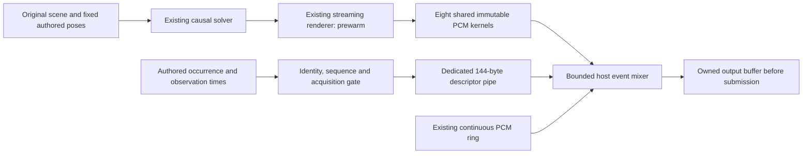

# LATENCY-02: prepared original transients and a dedicated descriptor path

I now have an offline transient preparation and transport prototype that avoids the Bati's 75/100 ms retrospective controls. Codex implemented it through my existing `CausalSimulation` and `StreamingRenderer`, using original synthetic impulses and finite authored geometry. It supplies shared prepared PCM and timestamped descriptors to the separate host mixer. It does not acquire or replace a GTA gunshot, and it does not establish audible or native input-to-ear latency.



The event worker performs file validation and kernel preparation before `READY`. It then emits descriptors only. It does not render, solve geometry, copy kernel PCM or wait for vehicle credits during event admission. The host owns the final output-frame mapping and bounded late mixing; Node never derives that mapping from a first fake callback or a minimum observed delivery delay.

## What is qualified

Each kernel binds one immutable original scene, scene generation, exact stationary source/listener pose and listener generation. The eight fixture preparations include unknown-space direct sound, an empty qualified scene, one wall, a passage, a separately prepared camera generation, two impact positions and a nearby direct source. A changed pose or generation needs a matching preparation. This is not a moving-listener or arbitrary live-origin solution.

The existing solver computes physical distances, reflection orders, passive band gains and stereo direction. The existing renderer prewarms its source/filter history, then processes one original impulse. Its stationary controls are exact time translations of that fixed solver result. The preparation's virtual stationary history is authored model input, not an arrived game observation or new runtime prediction.

| Original fixture | Direct travel | Additional finite arrivals |
| --- | --- | --- |
| Source 3.43 m from listener | 480 frames / 10 ms | None in the empty fixture |
| One wall 5 m to the side | Same direct path | First order: 1,479.448 frames / 30.822 ms total travel |
| Passage with walls at ±5 m | Same direct path | Two first-order paths; two second-order paths at 2,839.696 frames / 59.160 ms total travel |
| Source 1 m from listener | 139.942 analytic frames / 2.915 ms | Conditional direct only |

Unknown geometry selects the explicitly labelled `conditional-direct-unobserved-space-assumed-clear` model. It is output-identical to the qualified empty fixture here, but it does not prove clear line of sight. A busy map worker can leave an existing immutable qualified kernel available; an intermediate or unknown map result cannot silently become a reflection. No installed geometry, native material, late-reverberation model or fake echo delay is introduced.

Exact Float32 nonzero bounds are separate from significant-tail bounds. Metadata records both, the 1e−10 significance threshold and the final 256-frame peak. The generic prototype retains a bounded window of the existing IIR response and measures its residual; it does not claim an IIR has a mathematically finite tail. These eight 8,192-frame preparations happen to have zero-valued final 256-frame regions. The raw PCM is never truncated at a threshold, normalized or zeroed to satisfy metadata.

Fractional source-history reads can put a nonzero sample just before the ceiling of analytic travel time. The metadata exposes this difference. The host may shift the whole kernel by the bounded rounding guard; it must retain the onset and report the guard. It must not add direct travel time again.

## Identity, clocks and bounds

Only an explicit branded `authored-fixture` capability can admit an `authored-impulse`. The [acquisition gate](LATENCY_02_SOURCE_EVENT_CAPABILITIES.md) keeps real direct and reflected events blocked, with GTA primary. Source IDs are fixed to the eight registered fixture slots. Identity, positive generation, source sequence and lifetime event ID are checked independently. Source and transport sequences start at zero; event IDs are 1–8,192 and cannot be reused during that fixture lifetime.

`occurrenceLowerQpc` and `occurrenceUpperQpc` remain the authored occurrence interval. `acquisitionBeforeQpc` is optional; `observationAfterQpc` remains observation/receipt. They are never substituted for each other. The Node prototype admits at most 2 ms of authored occurrence uncertainty and 250 ms from the upper occurrence bound to observation. That latter bound is event observation lateness, not measured live pose freshness. The host separately validates ingress age, its presentation-clock mapping, actual scheduling and late policy.

The 144-byte little-endian `RAE2` descriptor carries the original ticks, explicit frequency, identity/generations, priority, uncertainty, late-policy limit and session bytes. `requestedEmissionOutputFrame` is always −1: the host maps the conservative occurrence bound on its independently established authored presentation clock. That map belongs to the device-free fixture; no actual WASAPI presentation-clock mapping is established here. The kernel starts at source emission and already contains propagation. If its nonzero onset is committed, any allowed late policy shifts the entire kernel and reports software lateness; it cannot rewrite occurrence time or remove the attack.

This pipe bypasses the continuous PCM FIFO, but remains FIFO itself. A priority flag cannot overtake bytes already buffered in the same pipe. The host can prioritize validated high/normal lanes after ingress; a blocked reader can delay both. Capacity and lateness limits must remain visible rather than being hidden by retries or queue growth.

| Capacity | Fixed prototype bound |
| --- | --- |
| Shared kernels | 8; at most 24,000 interleaved stereo frames each / 1,536,000 PCM bytes total |
| Actual eight-fixture PCM payload | 524,288 bytes |
| Host polyphony / queued descriptors | 32 active voices / 128 queued descriptors |
| Node packet ownership | 128 preallocated 144-byte buffers, returned only by write completion |
| Node input | One at most 16 KiB chunk and one at most 4 KiB ASCII JSON line |
| Source/event bookkeeping | 8 sources and an 8,193-byte lifetime event-ID table |
| Kernel pressure | At most 0.001 absolute peak each; 32 coherent voices bound at 0.032 |

The 0.95 continuous-stream budget plus the 0.032 event bound is below 0.99. These are authored headroom assumptions, not loudness or perceptual acceptance. The Bati source, calibration and gains are unchanged. Kernel preparation has temporary renderer history and ordinary process/GC costs; the shared-PCM table is not a whole-process memory limit.

## Functional evidence and reproduction

Codex's focused kernel/descriptor/wire suite passes 14 tests. With the nine acquisition tests, the combined command passes 23, with no failure or skip. It checks independently calculated image distances, exact direct onset, raw PCM hashes, immutable kernel ownership, camera and pose binding, 3,000 automatic-fire/concurrent-source descriptor admissions, occurrence/receipt separation, lifetime deduplication and every wire offset.

The real Node pipe fixture passes six functional cases and verifies 2,000 descriptors split every 37 input bytes. Its stdout reader deliberately pauses for 200 ms after `READY`. The measured packet-pool and write-completion statistics are preserved in the evidence, with no buffer corruption. `write(false)` need not occur: the smaller preallocated pool can itself supply backpressure. This deliberately stalled pipe is adverse functional evidence, not a nearby onset or performance result. Duplicate events, wrong origins, oversized lines, altered copied preparation metadata and oversized preparation files terminate without retry. The original private receipts remain unchanged.

```powershell
node --test tests/Test-TransientEventPath.mjs tests/Test-EventAcquisitionCapability.mjs
node tools/Test-TransientEventTransport.mjs
node tools/Prepare-TransientEventFixture.mjs --output <new-private-checkout-local-directory>
node tools/Run-TransientEventFixture.mjs --prepared <preparation.json> --session <fresh-32-hex-fixture-session>
```

Prepared files are private original renders, not device recordings. They can be avoided by importing the fixture library for in-memory registration. The runtime worker checks stored PCM and reproduces all deterministic kernel metadata once before `READY`; per-event traffic contains no PCM. Source and payload fingerprints, physical arrivals and the functional receipt are in [the sanitized evidence](../evidence/latency-02-prepared-transients.json).

The 20–30 ms nearby observation-to-submission target needs the host's separate timing fixture, including scheduling jitter, overload, simultaneous continuous sound and map-worker contention. The Node functional evidence does not measure submission or speaker latency. Real event acquisition, dynamic listener/source motion, native coexistence and endpoint period qualification remain separate gates. No GTA/RPH launch, endpoint, deployment, native suppression, installed asset or recording was used.
